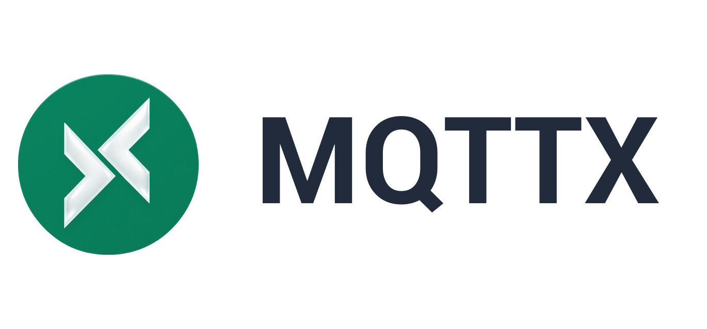
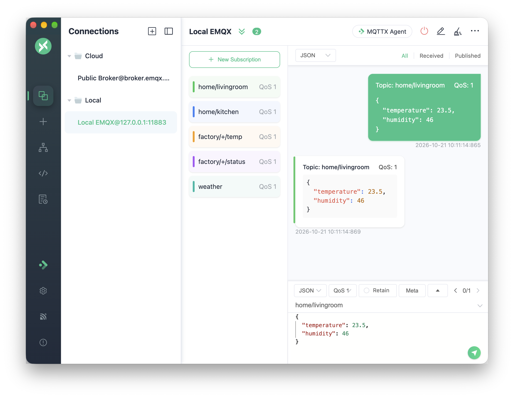
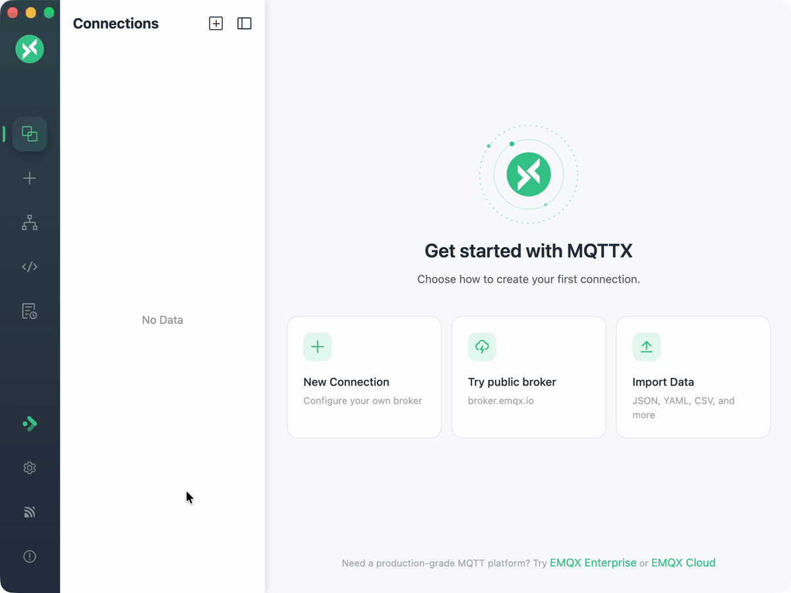

[](https://github.com/emqx/mqttx/releases)


[](https://github.com/emqx/mqttx/releases)
[](https://slack-invite.emqx.io/) [](https://discord.gg/xYGf3fQnES)
[](https://github.com/emqx/MQTTX/discussions)
[](https://www.youtube.com/channel/UCir_r04HIsLjf2qqyZ4A8Cg)
[](https://x.com/EMQTech)

---

[MQTTX](https://mqttx.app/zh) 是 [EMQ](https://www.emqx.com/zh) 开源的 [MQTT 5.0](https://www.emqx.com/zh/blog/introduction-to-mqtt-5) 客户端，提供适用于 macOS、Linux 和 Windows 的[桌面版](https://mqttx.app/zh/docs)、适用于脚本和压测的[命令行工具](https://mqttx.app/zh/docs/cli)，以及在浏览器中直接使用的 [Web 版](https://mqttx.app/web-client)。它采用类似聊天软件的界面，可以同时管理多个连接，通过 TCP、TLS 和 WebSocket 快速测试发布、订阅等 MQTT 功能，桌面版还内置了 MQTTX Agent，一个可以用自然语言操作 MQTTX 的 AI Agent。

> [MQTT](https://www.emqx.com/zh/blog/the-easiest-guide-to-getting-started-with-mqtt)（Message Queuing Telemetry Transport，消息队列遥测传输）是一种基于发布/订阅模式的轻量级消息协议，专为受限设备以及低带宽、高延迟或不可靠的网络而设计。

## 功能特性

桌面版的主要功能：

- **MQTTX Agent**：用自然语言操作 MQTTX，可以创建连接、订阅、发布、读取消息、诊断问题和生成客户端代码，支持技能（Skills）、MCP、操作审批和多家模型提供商。
- **协议**：支持 MQTT 3.1、3.1.1 和 5.0，可通过 TCP、TLS、WebSocket 和安全 WebSocket 连接。
- **MQTT 5.0**：连接、发布和订阅的用户属性；SCRAM 增强认证；连接页显示 CONNACK 响应信息。
- **Payload**：支持 Plaintext、JSON、Base64、Hex、CBOR 和 MsgPack，并支持 Protobuf 和 Avro Schema，接收消息时还可自动解压 GZIP。
- **自动化**：使用脚本在发布或接收时转换 Payload，支持定时发送消息。
- **视图器**：主题树、仪表盘、流量监控，以及支持 JSON 树和差异视图的消息体查看器。
- **工作流**：消息搜索、每个连接独立的发布区和发布历史，以及连接分组。
- **数据**：以 JSON、CSV、Excel、XML 或 YAML 格式导入和导出连接；JSON 备份会保留连接分组。
- **个性化**：浅色、深色和夜间主题；支持 English、简体中文、日本語、Türkçe、Magyar 和 한국어。

## MQTTX Agent

MQTTX Agent 是内置于桌面版的 AI 助手。在**设置 → MQTTX Agent** 中启用并填写服务商的 API Host、API Key 和模型后，即可从左侧栏以全屏打开，或用 `Cmd/Ctrl + J` 以浮窗打开。

- 它通过工具操作 MQTTX：创建并连接连接、订阅与发布、读取消息、构建主题树和仪表盘、调用你配置的 MCP 服务器，以及编写客户端代码、测试数据和编解码。
- **操作前询问**（默认）会在改动前请求批准，**自动**则不再询问。
- 对话和工具调用结果会发送给你配置的模型服务商，请避免在对话中输入密钥等敏感信息。

完整的配置、技能、MCP、权限和限制说明请参阅 [MQTTX Agent](./docs/desktop/zh/use-desktop/agent.md)。

## 功能预览



## 安装

桌面版可以通过以下方式安装。

### macOS App Store

[](https://apps.apple.com/cn/app/mqttx/id1514074565?mt=12)

### Homebrew

macOS 用户也可以使用 [Homebrew](https://formulae.brew.sh/cask/mqttx) 安装：

```shell
brew install --cask mqttx
```

### Linux

[](https://snapcraft.io/mqttx)
<a href='https://flathub.org/apps/details/com.emqx.MQTTX'></a>

### 发行包

从 [GitHub Releases](https://github.com/emqx/MQTTX/releases) 下载对应平台的安装包。国内用户也可以从 [EMQ 下载站](https://www.emqx.com/zh/downloads/MQTTX/) 下载。

### MQTTX CLI

macOS 用户可以使用 Homebrew 安装，其它平台可以使用 npm 安装：

```shell
brew install emqx/mqttx/mqttx-cli
npm install --global mqttx-cli
```

也提供独立的二进制文件和 Docker 镜像，详见 [MQTTX CLI README](./cli/README-CN.md) 或 [MQTTX 下载页面](https://mqttx.app/zh/downloads)。

### MQTTX Web

在浏览器中打开 <https://mqttx.app/web-client> 即可使用，也可以使用 Docker 自行部署：

```shell
docker run -d --name mqttx-web -p 80:80 emqx/mqttx-web:latest
```

详见 [MQTTX Web README](./web/README-CN.md)。

## 在 AI Agent 中使用 MQTTX CLI

### 安装或更新 MQTTX CLI

[INSTALL.md](./INSTALL.md) 提供面向 agent 的安装与更新步骤，包括环境检测、安装渠道选择和版本验证。可以将下面的提示词交给 agent：

> 读取 https://raw.githubusercontent.com/emqx/MQTTX/main/INSTALL.md，按照其中的步骤为当前环境安装或更新 MQTTX CLI，并验证命令路径和版本。

### 使用 MQTTX CLI skill

[mqttx-cli skill](./skills/mqttx-cli/SKILL.md) 帮助 agent 使用 MQTTX CLI 完成连接检查、消息收发、MQTT 5 功能验证、TLS/认证、编解码、压测、数据模拟和故障排查。

通过 [Skills CLI](https://github.com/vercel-labs/skills) 安装：

```shell
npx skills add emqx/MQTTX --skill mqttx-cli
```

从本地源码安装时，在仓库根目录运行 `npx skills add . --skill mqttx-cli`。也可以将整个 `skills/mqttx-cli` 目录（包括 `references`）复制到 agent 支持的技能目录，或让 agent 直接读取其中的 `SKILL.md`。

安装后，可以这样描述任务：

> 使用 mqttx-cli skill，验证本地 127.0.0.1:1883 broker 的消息收发。使用 mqttx-test/ 下的唯一 topic，在 15 秒内结束检查，并报告结果。

## 使用

完整说明请查看 [文档](https://mqttx.app/zh/docs) 或 [使用手册](./docs/manual-cn.md)。

1. 准备 MQTT Broker。

   - 如果不想在本地部署，可以使用 [EMQX Cloud](https://www.emqx.com/zh/cloud) 提供的免费[公共 MQTT 5.0 服务器](https://www.emqx.com/zh/mqtt/public-mqtt5-broker)：

      ```text
      地址: broker.emqx.io
      TCP 端口: 1883
      SSL/TLS 端口: 8883
      ```

   - 如果要在本地运行 Broker，推荐使用 [EMQX](https://www.emqx.com/zh/products/emqx)，一款开源、云原生、分布式的物联网 MQTT 消息服务器。

2. 点击左侧边栏的 `+` 按钮，填写表单中的必填项。

3. 点击右上角的 `Connect` 按钮连接到 Broker。

4. 连接成功后，即可订阅主题并发布消息进行测试。



## 与 EMQX 搭配使用

MQTTX 可以连接任何 MQTT Broker，与 EMQX 搭配使用效果更佳。只需几步即可连接到 EMQX 或 EMQX Cloud，调试您的应用并探索 Broker 的各项功能。

- [免费试用 EMQX Cloud 14 天](https://www.emqx.com/zh/try?product=cloud)
- [下载 EMQX 并在本地运行](https://www.emqx.com/zh/try?product=enterprise)

## 社区

- 访问 [EMQ 问答社区](https://askemq.com/) 以获取帮助，也可以分享您的想法或项目。
- 添加小助手微信号 `emqmkt`，加入 EMQ 微信技术交流群。
- 加入我们的 [Discord](https://discord.gg/xYGf3fQnES)，参与实时讨论。
- 关注我们的 [bilibili](https://space.bilibili.com/522222081)，获取最新物联网技术分享。
- 关注我们的 [微博](https://weibo.com/emqtt) 或 [Twitter](https://x.com/EMQTech)，获取 EMQ 最新资讯。

## 开发

以下步骤适用于桌面版。其它版本请参考 [CLI README](./cli/README-CN.md#开发) 和 [Web README](./web/README-CN.md#开发)。

请使用 [`.nvmrc`](./.nvmrc) 中指定的 Node.js 版本（当前为 v22）。如果使用 [nvm](https://github.com/nvm-sh/nvm)，在仓库根目录运行 `nvm use` 即可。

``` shell
# 克隆项目
git clone git@github.com:emqx/MQTTX.git

# 安装依赖
cd MQTTX
yarn install

# 以开发模式运行，支持热重载
yarn run electron:serve

# 构建 Windows、Linux 和 macOS 安装包
yarn run electron:build
```

安装包会输出到 `dist_electron` 目录。如果只需构建单个平台，请运行以下命令之一：

```shell
# For Windows
yarn run electron:build-win

# For Linux
yarn run electron:build-linux

# For macOS
yarn run electron:build-mac
```

## 贡献

提交 Pull Request 前，请先阅读 [贡献指南](https://github.com/emqx/MQTTX/blob/main/.github/CONTRIBUTING_CN.md)。

## 技术栈

- [Electron](https://electronjs.org/)
- [Vue](https://vuejs.org/) + [Element](https://element.eleme.io)
- [TypeScript](https://www.typescriptlang.org/)
- [TypeORM](https://github.com/typeorm/typeorm)
- [sqlite3](https://github.com/TryGhost/node-sqlite3)
- [MQTT.js](https://github.com/mqttjs/MQTT.js)

## 相关资源

- [MQTT 入门及进阶](https://www.emqx.com/zh/mqtt)

  EMQ 提供了通俗易懂的技术文章及简单易用的客户端工具，帮助您学习 MQTT 并快速入门 MQTT 客户端编程。

- [MQTT SDKs](https://www.emqx.com/zh/mqtt-client-sdk)

  我们选取了各个编程语言中热门的 MQTT 客户端 SDK，并提供代码示例，帮助您快速掌握 MQTT 客户端库的使用。

## License

Apache License 2.0, see [LICENSE](https://github.com/emqx/MQTTX/blob/main/LICENSE).
