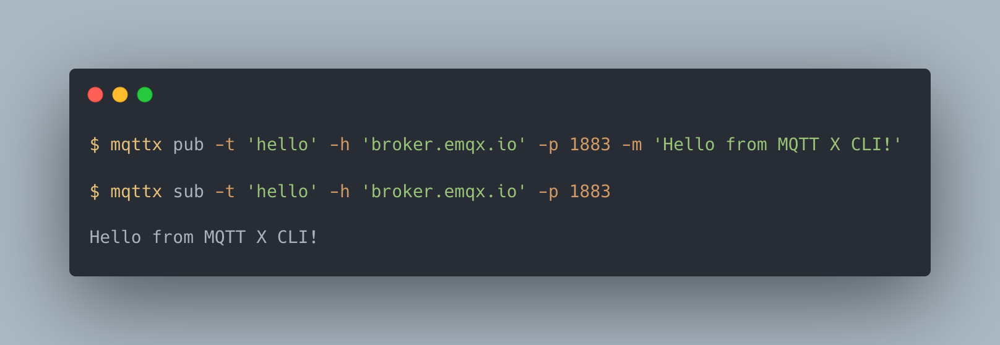

# MQTTX 命令行工具

[](https://github.com/emqx/mqttx/releases)


[](https://github.com/emqx/mqttx/releases)
[](https://hub.docker.com/r/emqx/mqttx-cli)
[](https://slack-invite.emqx.io/) [](https://discord.gg/xYGf3fQnES)
[](https://github.com/emqx/MQTTX/discussions)
[](https://www.youtube.com/channel/UCir_r04HIsLjf2qqyZ4A8Cg)
[](https://twitter.com/EMQTech)

[English](https://github.com/emqx/MQTTX/blob/main/cli/README.md) | 简体中文

---

[MQTTX CLI](https://mqttx.app/zh/cli) 是一款开源的 MQTT 5.0 命令行客户端工具，也是命令行上的 MQTTX，旨在帮助开发者在不需要使用图形化界面的基础上，也能更快的开发和调试 MQTT 服务与应用。

> [MQTT](https://www.emqx.com/zh/blog/the-easiest-guide-to-getting-started-with-mqtt) 全称为 Message Queuing Telemetry Transport（消息队列遥测传输）是一种基于 发布/订阅 范式的“轻量级”消息协议，旨在用于受限设备和低带宽，高延迟或不可靠的网络，由 IBM 发布。

## 功能预览



## 文档

关于介绍、安装和使用，请参阅 [MQTTX CLI 文档](https://mqttx.app/zh/docs/cli)，下面是一个快速入门指南。

## 安装

使用安装脚本安装 MQTTX CLI：

macOS / Linux：

```shell
curl -fsSL https://emqx.sh/mqttx | sh
```

Windows（PowerShell）：

```powershell
irm https://emqx.sh/mqttx.ps1 | iex
```

从 [MQTTX 下载页面](https://mqttx.app/zh/downloads)选择已发布的 MQTTX CLI 版本，并按操作系统和 CPU 架构下载安装。完整安装步骤请参阅 [CLI 安装文档](https://mqttx.app/zh/docs/cli/downloading-and-installation)。

macOS 用户也可以使用 Homebrew：

```shell
brew install emqx/mqttx/mqttx-cli
```

使用 npm 安装前，请检查已发布版本要求的 Node.js 范围，确认本机环境兼容；独立二进制文件自带运行环境：

```shell
npm view mqttx-cli@latest version engines --json
npm install mqttx-cli -g
```

也可以使用 Docker：

```shell
docker run -it --rm emqx/mqttx-cli
```

安装后检查版本：

```shell
mqttx --version
```

从 v1.13.3 起，可运行 `mqttx update`，就地更新现有的独立二进制、npm 或 Homebrew 安装。

## AI Agent 支持

### 安装或更新 MQTTX CLI

[INSTALL.md](https://github.com/emqx/MQTTX/blob/main/INSTALL.md) 提供面向 agent 的安装与更新步骤，包括环境检测、安装渠道选择和版本验证。可以将下面的提示词交给 agent：

> 读取 https://raw.githubusercontent.com/emqx/MQTTX/main/INSTALL.md，按照其中的步骤为当前环境安装或更新 MQTTX CLI，并验证命令路径和版本。

### 使用 MQTTX CLI skill

[mqttx-cli skill](https://github.com/emqx/MQTTX/blob/main/skills/mqttx-cli/SKILL.md) 帮助 agent 使用 MQTTX CLI 完成连接检查、消息收发、MQTT 5 功能验证、TLS/认证、编解码、压测、数据模拟和故障排查。

通过 [Skills CLI](https://github.com/vercel-labs/skills) 安装：

```shell
npx skills add emqx/MQTTX --skill mqttx-cli
```

从本地源码安装时，在仓库根目录运行 `npx skills add . --skill mqttx-cli`。也可以将整个 `skills/mqttx-cli` 目录（包括 `references`）复制到 agent 支持的技能目录，或让 agent 直接读取其中的 `SKILL.md`。

安装后，可以这样描述任务：

> 使用 mqttx-cli skill，验证本地 127.0.0.1:1883 broker 的消息收发。使用 mqttx-test/ 下的唯一 topic，在 15 秒内结束检查，并报告结果。

## 使用

在安装完成后，可在终端直接运行 `mqttx` 命令：

### 快速使用

Connect

```shell
mqttx conn -h 'broker.emqx.io' -p 1883 -u 'admin' -P 'public'
```

Subscribe

```shell
mqttx sub -t 'hello' -h 'broker.emqx.io' -p 1883
```

Publish

```shell
# Publish a single message
mqttx pub -t 'hello' -h 'broker.emqx.io' -p 1883 -m 'from MQTTX CLI'

# Publish multiple messages (multiline)
mqttx pub -t 'hello' -h 'broker.emqx.io' -p 1883 -s -M
```

Benchmark

```bash
# Connect Benchmark
mqttx bench conn -c 5000

# Subscribe Benchmark
mqttx bench sub -c 5000 -t bench/%i

# Publish Benchmark
mqttx bench pub -c 5000 -t bench/%i
```

Simulate

```bash
# Specify a local scenario and start the simulation
mqttx simulate -sc tesla -c 10

# Specify a scenario file and start the simulation
mqttx simulate -f <scenario file path> -c 10

# List the built-in scenarios
mqttx ls -sc
```

### 参数介绍

```shell
mqttx --help
```

| 参数          | 描述                        |
| ------------- | --------------------------- |
| -v, --version | 输出当前 MQTTX CLI 的版本号 |
| -h, --help    | 展示 mqttx 命令的帮助信息   |

| 命令     | 描述                             |
| -------- | -------------------------------- |
| check    | 检查更新                         |
| conn     | 创建一个连接并连接到 MQTT Broker |
| pub      | 向主题发布一条消息               |
| sub      | 订阅一个或多个主题               |
| bench    | MQTT 性能测试                    |
| simulate | MQTT 模拟器                      |

### 连接

```shell
mqttx conn --help
```

| 参数                                             | 描述                                                                                       |
| ------------------------------------------------ | ------------------------------------------------------------------------------------------ |
| -V, --mqtt-version \<5.0/3.1.1/3.1\>                 | MQTT 版本，默认为 5                                                                        |
| -h, --hostname \<HOST\>                            | MQTT Broker 的 Host 地址，默认为 localhost                                                 |
| -p, --port \<PORT\>                                | MQTT Broker 的端口号                                                                       |
| -i, --client-id \<ID\>                             | 客户端 ID                                                                                  |
| --no-clean                                       | 关闭 Clean Session / Clean Start（默认开启）                                                     |
| -k, --keepalive \<SEC\>                            | MQTT 的 Keep Alive，默认为 30                                                              |
| -u, --username \<USER\>                            | 连接到 MQTT Broker 的用户名                                                                |
| -P, --password \<PASS\>                            | 连接到 MQTT Broker 的密码                                                                  |
| -l, --protocol \<PROTO\>                           | 连接时的协议，支持 mqtt、mqtts、ws、wss，默认为 mqtt                                       |
| --path \<PATH\>                                    | websocket 的路径，默认为 /mqtt                                                             |
| --key \<PATH\>                                     | key 文件的路径                                                                             |
| --cert \<PATH\>                                    | cert 文件的路径                                                                            |
| --ca \<PATH\>                                             | ca 证书的文件路径                                                                          |
| --insecure                                       | 取消服务器的证书校验                                                                       |
| -rp, --reconnect-period \<MILLISECONDS\>           | 自动重连的间隔时间，通过设置为 0 来禁用自动重连，默认为 1000ms                             |
| --maximum-reconnect-times \<NUMBER\>               | 最大重连次数，默认为 10                                                                    |
| -up, --user-properties \<USERPROPERTIES...\>       | MQTT 5.0 用户属性，例如：-up "name: mqttx cli"                                             |
| -Wt, --will-topic \<TOPIC\>                        | 遗嘱消息的 Topic                                                                           |
| -Wm, --will-message \<BODY\>                       | 遗嘱消息的 Payload                                                                         |
| -Wq, --will-qos \<0/1/2\>                          | 遗嘱消息的 QoS                                                                             |
| -Wr, --will-retain                               | 发送的遗嘱消息为保留消息，默认为 false                                                     |
| -Wd, --will-delay-interval \<SECONDS\>             | 遗嘱消息延迟间隔，单位为秒                                                                 |
| -Wpf, --will-payload-format-indicator            | 遗嘱消息是否为UTF-8编码的字符数据                                                          |
| -We, --will-message-expiry-interval \<SECONDS\>    | 遗嘱信息的有效期，单位为秒                                                                 |
| -Wct, --will-content-type \<CONTENTTYPE\>          | 遗嘱消息内容的描述                                                                         |
| -Wrt, --will-response-topic \<TOPIC\>              | 响应信息的主题名称                                                                         |
| -Wcd, --will-correlation-data \<DATA\>             | 响应信息的关联数据                                                                         |
| -Wup, --will-user-properties \<USERPROPERTIES...\> | 遗嘱消息的自定义用户属性                                                                   |
| -se, --session-expiry-interval \<SECONDS\>         | 会话过期间隔，单位为秒                                                                     |
| --rcv-max, --receive-maximum \<NUMBER\>            | 接收消息的最大值                                                                           |
| --maximum-packet-size \<NUMBER\>                   | 客户端愿意接受的最大数据包大小                                                             |
| --topic-alias-maximum \<NUMBER\>                   | 主题别名的最大值                                                                           |
| --req-response-info                              | 客户端要求服务器提供的响应信息                                                             |
| --no-req-problem-info                            | 不请求服务器返回问题信息                                                                 |
| -so, --save-options \[PATH\]                                  | 将参数保存到本地配置文件中，文件支持 json 和 yaml 格式，默认路径为 ./mqttx-cli-options.json |
| -lo, --load-options \[PATH\]                                | 从本地配置文件加载参数，文件支持 json 和 yaml 格式，默认路径为 ./mqttx-cli-options.json     |
| --help                                           | 展示 conn 命令的帮助信息                                                                   |

### 订阅

```shell
mqttx sub --help
```

| 参数                                             | 描述                                                                                       |
| ------------------------------------------------ | ------------------------------------------------------------------------------------------ |
| -V, --mqtt-version \<5.0/3.1.1/3.1\>                 | MQTT 版本，默认为 5                                                                        |
| -h, --hostname \<HOST\>                            | MQTT Broker 的 Host 地址，默认为 localhost                                                 |
| -p, --port \<PORT\>                                | MQTT Broker 的端口号                                                                       |
| -i, --client-id \<ID\>                             | 客户端 ID                                                                                  |
| -q, --qos \<0/1/2...\>                                | 消息的 QoS，默认为 0                                                                       |
| --no-clean                                       | 关闭 Clean Session / Clean Start（默认开启）                                                     |
| -t, --topic \<TOPIC...\>                              | 需要订阅的 Topic                                                                           |
| -k, --keepalive \<SEC\>                            | MQTT 的 Keep Alive，默认为 30                                                              |
| -u, --username \<USER\>                            | 连接到 MQTT Broker 的用户名                                                                |
| -P, --password \<PASS\>                            | 连接到 MQTT Broker 的密码                                                                  |
| -l, --protocol \<PROTO\>                           | 连接时的协议，支持 mqtt、mqtts、ws、wss，默认为 mqtt                                       |
| --path \<PATH\>                                    | websocket 的路径，默认为 /mqtt                                                             |
| -nl, --no_local \[FLAG...\]                                  | MQTT 5.0 订阅选项中的 no local 标识                                                        |
| -rap, --retain-as-published \[FLAG...\]                      | MQTT 5.0 订阅选项中的 retain as published 标识                                             |
| -rh, --retain-handling \<0/1/2...\>                   | MQTT 5.0 订阅选项中的 retain handling 标识                                                 |
| --key \<PATH\>                                     | key 文件的路径                                                                             |
| --cert \<PATH\>                                    | cert 文件的路径                                                                            |
| --ca \<PATH\>                                             | ca 证书的文件路径                                                                          |
| --insecure                                       | 取消服务器的证书校验                                                                       |
| -rp, --reconnect-period \<MILLISECONDS\>           | 自动重连的间隔时间，通过设置为 0 来禁用自动重连，默认为 1000ms                             |
| --maximum-reconnect-times \<NUMBER\>               | 最大重连次数，默认为 10                                                                    |
| -up, --user-properties \<USERPROPERTIES...\>       | MQTT 5.0 用户属性，例如：-up "name: mqttx cli"                                             |
| -f, --format \<TYPE\>                              | 消息格式化类型，支持 base64、json、hex、binary、cbor 和 msgpack                                                     |
| -v, --verbose                                    | 在接收到的 Payload 前显示当前 Topic                                                        |
| --output-mode \<default/clean\>                    | 选择默认或简洁模式，简洁模式会输出完整的数据包，允许用户使用 jq 这类工具自由管理输出       |
| -Wt, --will-topic \<TOPIC\>                        | 遗嘱消息的 Topic                                                                           |
| -Wm, --will-message \<BODY\>                       | 遗嘱消息的 Payload                                                                         |
| -Wq, --will-qos \<0/1/2\>                          | 遗嘱消息的 QoS                                                                             |
| -Wr, --will-retain                               | 发送的遗嘱消息为保留消息，默认为 false                                                     |
| -Wd, --will-delay-interval \<SECONDS\>             | 遗嘱消息延迟间隔，单位为秒                                                                 |
| -Wpf, --will-payload-format-indicator            | 遗嘱消息是否为UTF-8编码的字符数据                                                          |
| -We, --will-message-expiry-interval \<SECONDS\>    | 遗嘱信息的有效期，单位为秒                                                                 |
| -Wct, --will-content-type \<CONTENTTYPE\>          | 遗嘱消息内容的描述                                                                         |
| -Wrt, --will-response-topic \<TOPIC\>              | 响应信息的主题名称                                                                         |
| -Wcd, --will-correlation-data \<DATA\>             | 响应信息的关联数据                                                                         |
| -Wup, --will-user-properties \<USERPROPERTIES...\> | 遗嘱消息的自定义用户属性                                                                   |
| -se, --session-expiry-interval \<SECONDS\>         | 会话过期间隔，单位为秒                                                                     |
| -si, --subscription-identifier \<NUMBER...\>          | 订阅标识符                                                                                 |
| --rcv-max, --receive-maximum \<NUMBER\>            | 接收消息的最大值                                                                           |
| --maximum-packet-size \<NUMBER\>                   | 客户端愿意接受的最大数据包大小                                                             |
| --topic-alias-maximum \<NUMBER\>                   | 主题别名的最大值                                                                           |
| --req-response-info                              | 客户端要求服务器提供的响应信息                                                             |
| --no-req-problem-info                            | 不请求服务器返回问题信息                                                                 |
| -Cup, --conn-user-properties \<USERPROPERTIES...\> | MQTT 5.0 的连接用户属性（例如，-Cup "name: mqttx cli"）                                    |
| -so, --save-options \[PATH\]                                  | 将参数保存到本地配置文件中，文件支持 json 和 yaml 格式，默认路径为 ./mqttx-cli-options.json |
| -lo, --load-options \[PATH\]                                | 从本地配置文件加载参数，文件支持 json 和 yaml 格式，默认路径为 ./mqttx-cli-options.json     |
| --help                                           | 展示 sub 命令的帮助信息                                                                    |
| -Pp, --protobuf-path \<PATH\>                      | 定义 Protocol Buffers（protobuf）消息格式的 .proto 文件路径                                |
| -Pmn, --protobuf-message-name \<NAME\>             | Protobuf 消息类型的名称（必须存在于 .proto 文件中）                                        |

### 发布

```shell
mqttx pub --help
```

| 参数                                             | 描述                                                                                       |
| ------------------------------------------------ | ------------------------------------------------------------------------------------------ |
| -V, --mqtt-version \<5.0/3.1.1/3.1\>                 | MQTT 版本，默认为 5                                                                        |
| -h, --hostname \<HOST\>                            | MQTT Broker 的 Host 地址，默认为 localhost                                                 |
| -p, --port \<PORT\>                                | MQTT Broker 的端口号                                                                       |
| -i, --client-id \<ID\>                             | 客户端 ID                                                                                  |
| -q, --qos \<0/1/2\>                                | 消息的 QoS，默认为 0                                                                       |
| --no-clean                                       | 关闭 Clean Session / Clean Start（默认开启）                                                     |
| -t, --topic \<TOPIC\>                              | 需要发布的 Topic                                                                           |
| -m, --message \<BODY\>                               | 需要发布的 Payload 消息                                                                    |
| -r, --retain                                     | 设置发送消息为 Retain 消息，默认为 false                                                   |
| -s, --stdin                                      | 从 stdin 中读取信息体                                                                      |
| -M, --multiline                                  | 可以通过多行发布多条消息                                                                   |
| -u, --username \<USER\>                            | 连接到 MQTT Broker 的用户名                                                                |
| -P, --password \<PASS\>                            | 连接到 MQTT Broker 的密码                                                                  |
| -f, --format \<TYPE\>                              | 输入消息的格式类型，支持 base64、json、hex、binary、cbor 和 msgpack                                               |
| -l, --protocol \<PROTO\>                           | 连接时的协议，支持 mqtt、mqtts、ws、wss，默认为 mqtt                                       |
| --path \<PATH\>                                    | websocket 的路径，默认为 /mqtt                                                             |
| --key \<PATH\>                                     | key 文件的路径                                                                             |
| --cert \<PATH\>                                    | cert 文件的路径                                                                            |
| --ca \<PATH\>                                             | ca 证书的文件路径                                                                          |
| --insecure                                       | 取消服务器的证书校验                                                                       |
| -rp, --reconnect-period \<MILLISECONDS\>           | 自动重连的间隔时间，通过设置为 0 来禁用自动重连，默认为 1000ms                             |
| --maximum-reconnect-times \<NUMBER\>               | 最大重连次数，默认为 10                                                                    |
| -up, --user-properties \<USERPROPERTIES...\>       | MQTT 5.0 用户属性，例如：-up "name: mqttx cli"                                             |
| -pf, --payload-format-indicator                  | 发布信息的有效载荷格式指标                                                                 |
| -e, --message-expiry-interval \<NUMBER\>           | 发布信息的有效期，单位为秒                                                                 |
| -ta, --topic-alias \<NUMBER\>                      | 主题别名，识别主题的值，而不是使用主题名称                                                 |
| -rt, --response-topic \<TOPIC\>                    | 作为响应信息的主题名称                                                                     |
| -cd, --correlation-data \<DATA\>                   | 请求信息的发送者在收到响应信息时用来识别是哪个请求的对比数据                               |
| -si, --subscription-identifier \<NUMBER\>          | 订阅标识符                                                                                 |
| -ct, --content-type \<TYPE\>                       | 对发布信息内容的描述                                                                       |
| -Wt, --will-topic \<TOPIC\>                        | 遗嘱消息的 Topic                                                                           |
| -Wm, --will-message \<BODY\>                       | 遗嘱消息的 Payload                                                                         |
| -Wq, --will-qos \<0/1/2\>                          | 遗嘱消息的 QoS                                                                             |
| -Wr, --will-retain                               | 发送的遗嘱消息为保留消息，默认为 false                                                     |
| -Wd, --will-delay-interval \<SECONDS\>             | 遗嘱消息延迟间隔，单位为秒                                                                 |
| -Wpf, --will-payload-format-indicator            | 遗嘱消息是否为UTF-8编码的字符数据                                                          |
| -We, --will-message-expiry-interval \<SECONDS\>    | 遗嘱信息的有效期，单位为秒                                                                 |
| -Wct, --will-content-type \<CONTENTTYPE\>          | 遗嘱消息内容的描述                                                                         |
| -Wrt, --will-response-topic \<TOPIC\>              | 响应信息的主题名称                                                                         |
| -Wcd, --will-correlation-data \<DATA\>             | 响应信息的关联数据                                                                         |
| -Wup, --will-user-properties \<USERPROPERTIES...\> | 遗嘱消息的自定义用户属性                                                                   |
| -se, --session-expiry-interval \<SECONDS\>         | 会话过期间隔，单位为秒                                                                     |
| --rcv-max, --receive-maximum \<NUMBER\>            | 接收消息的最大值                                                                           |
| --maximum-packet-size \<NUMBER\>                   | 客户端愿意接受的最大数据包大小                                                             |
| --topic-alias-maximum \<NUMBER\>                   | 主题别名的最大值                                                                           |
| --req-response-info                              | 客户端要求服务器提供的响应信息                                                             |
| --no-req-problem-info                            | 不请求服务器返回问题信息                                                                 |
| -Cup, --conn-user-properties \<USERPROPERTIES...\> | MQTT 5.0 的连接用户属性（例如，-Cup "name: mqttx cli"）                                    |
| -so, --save-options \[PATH\]                                  | 将参数保存到本地配置文件中，文件支持 json 和 yaml 格式，默认路径为 ./mqttx-cli-options.json |
| -lo, --load-options \[PATH\]                                | 从本地配置文件加载参数，文件支持 json 和 yaml 格式，默认路径为 ./mqttx-cli-options.json     |
| --help                                           | 展示 pub 命令的帮助信息                                                                    |
| -Pp, --protobuf-path \<PATH\>                      | 定义 Protocol Buffers（protobuf）消息格式的 .proto 文件路径                                |
| -Pmn, --protobuf-message-name \<NAME\>             | Protobuf 消息类型的名称（必须存在于 .proto 文件中）                                        |

### Batch 消息

从 v1.14.0 起，Batch 可将同一逻辑主题下的多条有序消息打包到一个 MQTT PUBLISH 中，支持 MQTT 5.0、MQTT 3.1.1，以及 QoS 0/1。使用前，确认 Broker 路由配置和消费者支持相同的批量格式及上限。以下示例假设 `localhost:1883` 已配置这样的路由；请按部署情况替换主机、端口、认证和 TLS 参数。

#### 发布与订阅

在一个终端启动订阅：

```bash
mqttx sub -h localhost -p 1883 -V 5.0 -q 1 -t demo/batch -b
```

在另一个终端准备 `items.txt`，每行一条消息：

```text
hello
{"temperature":23.5}
world
```

```bash
mqttx pub -h localhost -p 1883 -V 5.0 -q 1 -t demo/batch -b --file-read items.txt
```

只有几条消息时，也可以重复传入 `-m`：

```bash
mqttx pub -h localhost -p 1883 -V 5.0 -q 1 -t demo/batch -b -m hello -m world
```

发布上述文件后，输出为 `Published 3 items in 1 batch`；订阅端显示批量条数和逐条编号。`sub` 不加 `-b` 时接收原始 MQTT 消息，不拆解条目；`sub -b` 也能接收普通消息。

#### 输入与上限

- 文件默认按 LF 或 CRLF 换行拆分。空行表示空条目；文件末尾的一个换行不会新增条目。输入不是 JSON 数组，每条 JSON 消息应独占一行。
- `pub -b --file-read` 可用 `--split ','` 指定分隔符。Unix 类系统可以用 `--file-read /dev/stdin` 读取管道；`-s`、`-M`、`-lm` 不作为 Batch 输入。
- `-f` 对每条消息应用所选编码。Batch 发布不支持逐条 Protobuf/Avro 编码，也不支持 `pub -S`。
- `pub` 默认按每包最多 **256 条、65,536 字节 Payload** 自动拆包。每条消息的两字节大端长度前缀计入字节上限。单条消息不能再拆分，且不得超过 65,535 字节或每包字节预算减去长度前缀。
- `sub` 使用相同默认上限。格式错误或超限时整批拒绝；发送更大批次时，应同步调高接收上限，并遵守路由限制。
- MQTT 5.0 Broker 返回的 Maximum Packet Size 限制完整 PUBLISH，包括报文头。超过该限制时 MQTTX 拒绝发送，不会按此限制再次自动拆包。

| 参数                          | 命令                                   | 说明                                                                               |
| ----------------------------- | -------------------------------------- | ---------------------------------------------------------------------------------- |
| `-b, --batch`                 | `pub`、`sub`、`bench pub`、`bench sub` | 开启 Batch 发布或解析、计数。                                                      |
| `--batch-max-items <NUMBER>`  | `pub`、`sub`                           | 每包最大条数，默认 `256`，范围 `1–65535`。                                         |
| `--batch-max-bytes <SIZE>`    | `pub`、`sub`                           | 含长度前缀的 Payload 字节上限，默认 `65536`，范围 `1024–1048576`。填写整数字节数。 |
| `--split [CHARACTER]`         | `pub`                                  | `-b --file-read` 的分隔符，默认换行。                                              |
| `-bi, --batch-items <NUMBER>` | `bench pub`                            | 每包条数，默认 `256`，范围 `1–65535`，必须配合 `-b`。                              |
| `--batch-negotiate`           | `pub`、`bench pub`                     | 要求 MQTT 5.0 Broker 在 CONNACK 中确认 `batch-publish=v1`。                        |

例如，将文件按每包最多 64 条、32 KiB Payload 拆包：

```bash
mqttx pub -h localhost -p 1883 -V 5.0 -q 1 -t demo/batch -b --file-read items.txt --batch-max-items 64 --batch-max-bytes 32768
```

#### MQTT 3.1.1 主题与 MQTT 5.0 协商

MQTT 5.0 保留发布主题，自动添加 `batch-format=v1` 和 `batch-size=N` User Properties。每条消息使用固定两字节长度前缀，不是 JSON 数组或 VBI 编码。不要手动添加这两个属性，也不要将 Payload Format Indicator 设为 `1`。

MQTT 3.1.1 自动添加 `$batch/{N}/` 前缀。发布时始终填写不带前缀的**逻辑主题**。`-b` 不改写订阅过滤器，因此订阅时要显式填写带前缀的主题：

```bash
# 终端 1
mqttx sub -h localhost -p 1883 -V 3.1.1 -q 1 -t '$batch/+/demo/topic' -b

# 终端 2：实际发布到 $batch/2/demo/topic
mqttx pub -h localhost -p 1883 -V 3.1.1 -q 1 -t demo/topic -b -m hello -m world
```

Shell 中须用引号包住 `$batch`。订阅 `#` 无法匹配这些主题。MQTT 3.1.1 Batch 不支持 Retain；MQTT 5.0 可在兼容路由上保留整批消息，清除时发送不带 `-b` 和 Batch 标记的普通保留空消息。

如果 MQTT 5.0 路由要求能力协商，在发布命令中添加 `--batch-negotiate`。CLI 会在 CONNECT 中声明能力，并在发送前检查 CONNACK 是否确认。不要同时添加 `-Cup 'batch-publish: v1'`。协商不能代替路由兼容性配置。

#### 性能测试

先启动订阅，再发送五个批次，每批 256 条：

```bash
# 终端 1
mqttx bench sub -h localhost -p 1883 -V 5.0 -q 1 -c 1 -t demo/batch -b

# 终端 2
mqttx bench pub -h localhost -p 1883 -V 5.0 -q 1 -c 1 -t demo/batch -b -bi 256 -m hello -im 1000 -L 5
```

`-L` 按包计数，因此共发送 1,280 条消息。输出分别统计包和条目。`bench pub -b` 会在每包内重复同一条目模板，来源是 `-m`、生成的 Payload，或 `--file-read` 读取的**整个文件**；它不会逐行拆文件，也不支持 `--split`。压测批次使用协议上限，不沿用 `pub`/`sub` 的默认上限，应按 Broker 路由限制选择 `-bi` 和单条大小。`bench sub -b` 统计校验通过的条目，并单独报告无效批次。

### 性能测试

性能测试命令与普通命令参数基本相同，以下仅列出新增或有变化的参数。

#### 连接性能测试

```shell
mqttx bench conn --help
```

| 参数                          | 描述                             |
| ----------------------------- | -------------------------------- |
| -c, --count \<NUMBER\>          | 连接数量，默认为 1000            |
| -i, --interval \<MILLISECONDS\> | 创建连接的间隔时间，默认为 10ms  |
| -I, --client-id \<ID\>          | 客户端 ID，支持 %i (索引) 占位符 |

#### 订阅性能测试

```shell
mqttx bench sub --help
```

| 参数                          | 描述                                                                 |
| ----------------------------- | -------------------------------------------------------------------- |
| -c, --count \<NUMBER\>          | 连接数量，默认为 1000                                                |
| -i, --interval \<MILLISECONDS\> | 创建连接的间隔时间，单位为毫秒，默认为 10ms                          |
| -I, --client-id \<ID\>          | 客户端 ID，支持 %i (索引) 占位符                                     |
| -t, --topic \<TOPIC...\>        | 需要订阅的 Topic, 支持 %u (用户名), %c (客户端 ID), %i (索引) 占位符 |
| -v, --verbose                 | 打印接收到的历史消息数量与消息速率                                   |

#### 发布性能测试

```shell
mqttx bench pub --help
```

| 参数                                   | 描述                                                                 |
| -------------------------------------- | -------------------------------------------------------------------- |
| -c, --count \<NUMBER\>                   | 连接数量，默认为 1000                                                |
| -i, --interval \<MILLISECONDS\>          | 创建连接的间隔时间，单位为毫秒，默认为 10ms                          |
| -im, --message-interval \<MILLISECONDS\> | 发布消息的间隔时间，单位为毫秒，默认为 1000ms                        |
| -I, --client-id \<ID\>                   | 客户端 ID，支持 %i (索引) 占位符                                     |
| -t, --topic \<TOPIC\>                 | 需要发布的 Topic, 支持 %u (用户名), %c (客户端 ID), %i (索引) 占位符 |
| -v, --verbose                          | 打印发送出的历史消息数量与消息速率                                   |
| ~~-s, --stdin~~                        | ~~从 stdin 中读取信息体~~                                            |
| ~~-M, --multiline~~                    | ~~可以通过多行发布多条消息~~                                         |

### 模拟器

用于模拟特定场景下 MQTT 发布消息操作。

模拟器命令与[发布性能测试](#发布性能测试)参数基本相同，以下仅列出新增或有变化的参数。

```shell
mqttx simulate --help
```

| 参数                            | 描述                                                                                                                             |
| ------------------------------- | -------------------------------------------------------------------------------------------------------------------------------- |
| -sc, --scenario \<SCENARIO\>      | 模拟内置场景的名称                                                                                                               |
| -f, --file \<SCENARIO FILE PATH\> | 本地自定义场景脚本的文件路径                                                                                                     |
| -t, --topic \<TOPIC\>          | 需要发布的消息主题, 可选, 支持 %u (用户名), %c (客户端 ID), %i (索引) 占位符,  %sc (场景) 占位符, 默认为 `mqttx/simulate/%sc/%c` |

`--scenario` 与 `--file` 参数必须指定一个，如果同时指定，优先使用 `--file` 参数。

自定义物联网数据模拟脚本示例：

<!-- TODO 在文档中补充更详细的信息并链接到文档。 -->

```js
/**
 * MQTTX 场景文件示例
 * 
 * 此脚本生成随机的温度和湿度数据。
 */
function generator (faker, options) {
  return {
    // 如果没有返回主题，则使用命令行参数中的主题。
    // 主题格式：'mqttx/simulate/myScenario/' + clientId,
    message: JSON.stringify({
      temp: faker.number.int({ min: 20, max: 80 }),  // 在 20 到 80 之间生成随机温度。
      hum: faker.number.int({ min: 40, max: 90 }),   // 在 40 到 90 之间生成随机湿度。
    })
  }
}
// 导出场景模块
module.exports = {
  name: 'myScenario',  // 场景名称
  generator,          // 生成器函数
}
```

对于更多示例和详细的编辑指南，请参考 MQTTX GitHub 仓库中的[脚本示例](https://github.com/emqx/MQTTX/tree/main/scripts-example/IoT-data-scenarios)，或查看如何使用 [faker.js](https://fakerjs.dev/) 来生成各种类型的随机数据。

### 列表

`list` 命令提供了可用资源的概览。

> 目前，该命令仅支持列出内置的场景。

```shell
mqttx list --help
```

| 参数             | 描述           |
| ---------------- | -------------- |
| -sc, --scenarios | 列出内置的场景 |

#### 内置场景

可以使用 `--scenarios` 选项来显示内置场景的列表。

```shell
mqttx list --scenarios
```

这个命令会输出一个表格，显示每个内置场景的名称和描述。如果想在模拟命令中使用其中一个，只需在 `--scenario` 选项中指定场景名称：

```shell
mqttx simulate --scenario <SCENARIO>
```

未来，`list` 命令将添加更多选项和功能。敬请期待！

## 与 EMQX 更好的合作

MQTTX 为连接测试 EMQX 等 MQTT 消息服务器而生，一键式的连接方式和简洁的图形界面可以帮助您快速连接到 EMQX 或 EMQX Cloud 调试并探索其功能特性。

[注册 EMQX Cloud 可以享受 14 天免费试用](https://www.emqx.com/zh/try?product=cloud)

[现在就本地下载并安装 EMQX](https://www.emqx.com/zh/try?product=enterprise)

[使用 Device Agent 让设备快速接入你的 AI 大脑](https://www.emqx.com/zh/device-agent)

## 社区

- 访问 [EMQ 问答社区](https://askemq.com/) 以获取帮助，也可以分享您的想法或项目。
- 添加小助手微信号 `emqmkt`，加入 EMQ 微信技术交流群。
- 加入我们的 [Discord](https://discord.gg/xYGf3fQnES)，参于实时讨论。
- 关注我们的 [bilibili](https://space.bilibili.com/522222081)，获取最新物联网技术分享。
- 关注我们的 [微博](https://weibo.com/emqtt) 或 [Twitter](https://twitter.com/EMQTech)，获取 EMQ 最新资讯。

## 开发

Node 环境的推荐版本:

- v18.\*.\*

```shell
# 克隆项目
git clone git@github.com:emqx/MQTTX.git

# 安装依赖
cd MQTTX/cli
yarn install

# 编译和热重载以进行开发
yarn run dev

# 编译和压缩以构建生产版本
yarn run build
```

构建成功后，会在 `dist` 目录里出现构建成功的相应的文件，需要在 Node.js 环境中使用。

如果需要打包一个二进制可执行文件，请参考以下命令：

```shell
# 全局安装 pkg
npm install pkg -g

# 构建二进制可执行文件
pkg package.json
```

构建成功后，在 `release` 目录里可以看到对应各系统的二进制可执行文件了。

## 贡献

请确保在发出 PR 请求前， 已经仔细阅读过了[贡献指南](https://github.com/emqx/MQTTX/blob/main/.github/CONTRIBUTING_CN.md)

## 技术栈

- [TypeScript](https://www.typescriptlang.org/)
- [Node.js](https://nodejs.org/en/)
- [pkg](https://github.com/vercel/pkg)
- [MQTT.js](https://github.com/mqttjs/MQTT.js)

## License

Apache License 2.0, see [LICENSE](https://github.com/emqx/MQTTX/blob/main/LICENSE).
