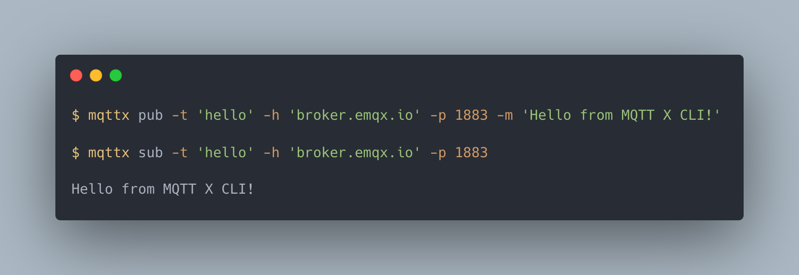

# MQTTX CLI

[](https://github.com/emqx/mqttx/releases)


[](https://mqttx.app/downloads)
[](https://hub.docker.com/r/emqx/mqttx-web)
[](https://hub.docker.com/r/emqx/mqttx-cli)  

[](https://github.com/emqx/MQTTX/discussions)
[](https://slack-invite.emqx.io/)
[](https://discord.gg/xYGf3fQnES)
[](https://www.youtube.com/channel/UC5FjR77ErAxvZENEWzQaO5Q)
[](https://twitter.com/EMQTech)

---

[MQTTX CLI](https://mqttx.app/cli) is an open source MQTT 5.0 CLI Client and MQTTX on the command line. Designed to help develop and debug MQTT services and applications faster without the need to use a graphical interface.

> [MQTT](https://www.emqx.com/en/blog/the-easiest-guide-to-getting-started-with-mqtt) stands for MQ Telemetry Transport. It is a publish/subscribe, extremely simple and lightweight messaging protocol, designed for constrained devices and low-bandwidth, high-latency or unreliable networks.

## Preview



## Documentation

Explore the full range of features and learn how to get the most out of MQTTX CLI with our comprehensive [MQTTX CLI Documentation](https://mqttx.app/docs/cli).

## Installation

Install MQTTX CLI with the install script:

macOS / Linux:

```shell
curl -fsSL https://emqx.sh/mqttx | sh
```

Windows (PowerShell):

```powershell
irm https://emqx.sh/mqttx.ps1 | iex
```

Homebrew, npm, Docker and standalone binaries: see the [installation docs](https://mqttx.app/docs/cli/downloading-and-installation).

From v1.13.3, run `mqttx update` to update an existing binary, npm or Homebrew installation in place.

## AI Agent Support

### Install or update MQTTX CLI

[INSTALL.md](https://github.com/emqx/MQTTX/blob/main/INSTALL.md) provides installation and update instructions for agents, including environment detection, package selection, and version verification. Give your agent this prompt:

> Read https://raw.githubusercontent.com/emqx/MQTTX/main/INSTALL.md and follow its instructions to install or update MQTTX CLI for this environment. Verify the executable path and version.

### Use the MQTTX CLI skill

The [mqttx-cli skill](https://github.com/emqx/MQTTX/blob/main/skills/mqttx-cli/SKILL.md) helps agents use MQTTX CLI for connection checks, messaging, MQTT 5 features, TLS/authentication, payload codecs, benchmarks, data simulation, and troubleshooting.

Install it with the [Skills CLI](https://github.com/vercel-labs/skills):

```shell
npx skills add emqx/MQTTX --skill mqttx-cli
```

To install from a local checkout, run `npx skills add . --skill mqttx-cli` from the repository root. You can also copy the entire `skills/mqttx-cli` directory (including `references`) into your agent's supported skills directory, or ask the agent to read its `SKILL.md` directly.

Once installed, try a task such as:

> Use the mqttx-cli skill to verify a publish/subscribe round trip against my local broker at 127.0.0.1:1883. Use a unique topic under mqttx-test/, finish within 15 seconds, and report the result.

## Quickstart

Once you've installed MQTTX CLI, you can immediately begin exploring its capabilities. Start with these basic commands:

- **Connect to a Broker**

  ```shell
  mqttx conn -h 'broker.emqx.io' -p 1883 -u 'admin' -P 'public'
  ```

- **Subscribe to a Topic**

  ```shell
  mqttx sub -t 'hello' -h 'broker.emqx.io' -p 1883
  ```

- **Publish a Message**

  ```shell
  mqttx pub -t 'hello' -h 'broker.emqx.io' -p 1883 -m 'from MQTTX CLI'
  ```

For additional information on usage and advanced features, please consult our [Getting Started Guide](https://mqttx.app/docs/cli/get-started).

## Batch Messages

From v1.14.0, batch mode packs ordered items into one MQTT PUBLISH on the same logical topic. It supports MQTT 5.0 and MQTT 3.1.1 with QoS 0 or 1.

> **Note:** Batch messages require MQTT broker support. Before using them, make sure your broker and subscribers support batch messages.

### Publish and subscribe

Start the subscriber in one terminal:

```bash
mqttx sub -h localhost -p 1883 -V 5.0 -q 1 -t demo/batch -b
```

In another terminal, create `items.txt` with one item per line and publish it:

```text
hello
{"temperature":23.5}
world
```

```bash
mqttx pub -h localhost -p 1883 -V 5.0 -q 1 -t demo/batch -b --file-read items.txt
```

For a few items, repeat `-m`:

```bash
mqttx pub -h localhost -p 1883 -V 5.0 -q 1 -t demo/batch -b -m hello -m world
```

The publisher reports `Published 3 items in 1 batch` for the file above. The subscriber shows the batch count and numbered items. Without `-b`, `sub` receives the ordinary MQTT envelope without splitting its items; `sub -b` still accepts ordinary messages.

### Input and limits

- File input splits on LF or CRLF by default. Empty lines are empty items; one final newline does not add an item. This is line input, not a JSON array. Each JSON item must fit on one line.
- `--split ','` selects a custom separator for `pub -b --file-read`. On Unix-like systems, pipe input with `--file-read /dev/stdin`; `-s`, `-M`, and `-lm` are not batch inputs.
- `-f` applies the selected encoding to each item. Batch publishing does not support per-item Protobuf/Avro schemas or `pub -S`.
- `pub` splits input into packets of at most **256 items** and **65,536 payload bytes** by default. Each item's two-byte big-endian length prefix counts toward the byte limit. An individual item cannot be split and cannot exceed 65,535 bytes or the configured packet budget minus its prefix.
- `sub` uses the same default limits. A malformed or oversized batch is rejected as a whole. Raise the receiver limits when publishing larger batches.
- The broker's MQTT 5.0 Maximum Packet Size applies to the complete PUBLISH, including headers. MQTTX rejects packets that exceed it; it does not automatically repack them to fit this limit.

| Option                        | Commands                               | Meaning                                                                                                    |
| ----------------------------- | -------------------------------------- | ---------------------------------------------------------------------------------------------------------- |
| `-b, --batch`                 | `pub`, `sub`, `bench pub`, `bench sub` | Enable batch publishing or decoding/counting.                                                              |
| `--batch-max-items <NUMBER>`  | `pub`, `sub`                           | Items per packet; default `256`, range `1–65535`.                                                          |
| `--batch-max-bytes <SIZE>`    | `pub`, `sub`                           | Payload bytes including length prefixes; default `65536`, range `1024–1048576`. Use an integer byte count. |
| `--split [CHARACTER]`         | `pub`                                  | Separator for `-b --file-read`; newline by default.                                                        |
| `-bi, --batch-items <NUMBER>` | `bench pub`                            | Items per packet; default `256`, range `1–65535`. Requires `-b`.                                           |
| `--batch-negotiate`           | `pub`, `bench pub`                     | Require MQTT 5.0 `batch-publish=v1` selection in CONNACK.                                                  |

For example, split a file into packets with at most 64 items and 32 KiB of payload:

```bash
mqttx pub -h localhost -p 1883 -V 5.0 -q 1 -t demo/batch -b --file-read items.txt --batch-max-items 64 --batch-max-bytes 32768
```

### MQTT 3.1.1 topics and MQTT 5.0 negotiation

MQTT 5.0 keeps the publish topic and adds `batch-format=v1` and `batch-size=N` User Properties automatically. The payload uses a fixed two-byte length prefix per item; it is not a JSON array or VBI framing. Do not add these properties manually or set Payload Format Indicator to `1`.

MQTT 3.1.1 prefixes the publish topic with `$batch/{N}/`. Always give `pub` the **logical topic**, without that prefix. Subscription filters are unchanged by `-b`, so subscribe explicitly to the prefixed topic:

```bash
# Terminal 1
mqttx sub -h localhost -p 1883 -V 3.1.1 -q 1 -t '$batch/+/demo/topic' -b

# Terminal 2: publishes to $batch/2/demo/topic
mqttx pub -h localhost -p 1883 -V 3.1.1 -q 1 -t demo/topic -b -m hello -m world
```

Quote `$batch` in a shell. A subscription to `#` does not match these topics. MQTT 3.1.1 batches cannot use Retain. MQTT 5.0 can retain a batch; clear it with an ordinary retained empty publication without `-b` or batch markers.

If an MQTT 5.0 broker requires negotiation, add `--batch-negotiate` to the publish command. It sends the CONNECT offer and requires the matching CONNACK selection before publishing. Do not also set `-Cup 'batch-publish: v1'`.

### Benchmark

Run the subscriber first, then publish five packets of 256 items each:

```bash
# Terminal 1
mqttx bench sub -h localhost -p 1883 -V 5.0 -q 1 -c 1 -t demo/batch -b

# Terminal 2
mqttx bench pub -h localhost -p 1883 -V 5.0 -q 1 -c 1 -t demo/batch -b -bi 256 -m hello -im 1000 -L 5
```

`-L` counts packets, so this publishes 1,280 items. Output distinguishes packets from items. `bench pub -b` repeats one item template in each packet: `-m`, a generated payload, or the **whole file** from `--file-read`. It does not split a file into items and rejects `--split`. Benchmark batches use protocol limits rather than the `pub`/`sub` defaults; choose `-bi` and the item size to fit the broker's limits. `bench sub -b` counts validated items and reports invalid batches separately.

## Better Together with EMQX

MQTTX is designed to connect to test MQTT Brokers such as EMQX, The one-click connection and simple graphical interface make it easy to connect to EMQX or EMQX Cloud to debug and explore functional features.

[Sign up EMQX Cloud for 14 days free trial](https://www.emqx.com/en/try?product=cloud)

[Download EMQX locally right now](https://www.emqx.com/en/try?product=enterprise)

[Connect your devices to your AI brain with Device Agent](https://www.emqx.com/en/device-agent)

## Get Involved

- Follow [@EMQTech on Twitter](https://twitter.com/EMQTech).
- If you have a specific question, check out our [discussion forums](https://github.com/emqx/emqx/discussions).
- For general discussions, join us on the [official Discord](https://discord.gg/xYGf3fQnES) team.
- Keep updated on [EMQX YouTube](https://www.youtube.com/channel/UC5FjR77ErAxvZENEWzQaO5Q) by subscribing.

## Develop

Recommended version for Node environment:

- v18.\*.\*

``` shell
# Clone
git clone git@github.com:emqx/MQTTX.git

# Install dependencies
cd MQTTX/cli
yarn install

# Compiles and hot-reloads for development
yarn run dev

# Compiles and minifies for production
yarn run build
```

After a successful build, the corresponding file for the successful build will appear in the `dist` directory and will need to be used in a Node.js environment.

If you need to package a binary executable, please refer to the following command.

```shell
# Install pkg lib
npm install pkg -g

# Build binary
pkg package.json
```

After a successful build, you will see the binary executable for each system in the `release` directory.

## Contributing

Please make sure to read the [Contributing Guide](https://github.com/emqx/MQTTX/blob/main/.github/CONTRIBUTING.md) before making a pull request.

## Technology Stack

- [TypeScript](https://www.typescriptlang.org/)
- [Node.js](https://nodejs.org/en/)
- [pkg](https://github.com/vercel/pkg)
- [MQTT.js](https://github.com/mqttjs/MQTT.js)

## License

Apache License 2.0, see [LICENSE](https://github.com/emqx/MQTTX/blob/main/LICENSE).
