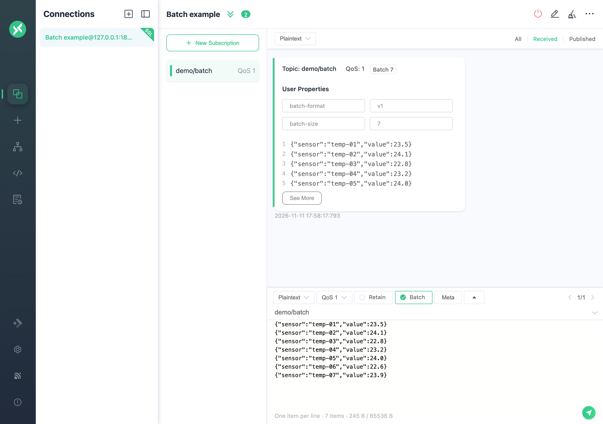
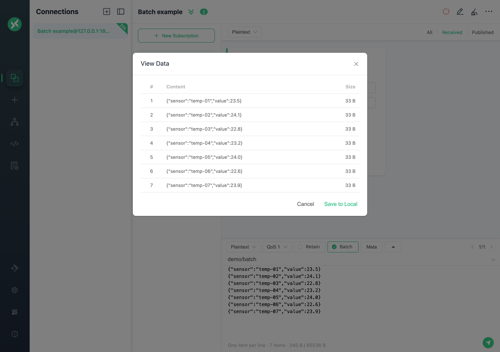

# Publish and Subscribe

## Main Interface

After connecting, expand the panel next to the connection name to view or edit basic settings. Disconnect before changing settings, then reconnect to apply them. The panel collapses after each successful connection. While disconnected, use the configuration button on the right for all connection settings.


## Add Subscription

Click `New Subscription` in the lower left corner and enter a [Topic](https://www.emqx.com/en/blog/advanced-features-of-mqtt-topics). Choose a color or use a randomly generated one. The button at the top right of the subscription list hides the list.

Click a subscription to filter messages; click it again to clear the filter, or select another subscription to change the filter. Click the topic name to copy it, then paste it into the publish area's topic field when needed.


Optionally, set a topic alias when adding a subscription. The list displays the alias, while hovering shows the original topic. Aliases help distinguish long topic names.


To add multiple topics at once, separate them with commas in the subscription dialog. Use commas to separate their aliases too.


Right-click a subscription to **Edit**, **Disable**, or **Enable** it. Disable a subscription to stop receiving its messages temporarily; enable it to resume without entering the topic again.


While disconnected, you can delete or disable subscriptions if Clean Session (MQTT 3.x) or Clean Start (MQTT 5.0) is enabled. MQTTX blocks these changes for persistent sessions: Clean Session disabled, or Clean Start disabled with a Session Expiry Interval greater than 0. The broker retains those subscriptions. Adding or editing a subscription still requires a connection.

## Publish and Receiving Messages

In the publish area, enter a subscribed topic, choose [QoS](https://www.emqx.com/en/blog/introduction-to-mqtt-qos) and `Retain`, enter the payload, and click Send. Sent messages appear on the right and received messages on the left. A message published to a subscribed topic appears in both. Press `Cmd + Enter` on macOS or `Ctrl + Enter` on other systems to publish.


Choose `Base64`, `Hex`, `JSON`, `Plaintext`, `CBOR`, or `MsgPack` in the publish area's `payload` selector. Use the format selector above the message list to decode received messages.

> **Note:** CBOR and MsgPack are efficient binary formats that can reduce payload size compared with JSON. Both use JSON for input and output.

For `Protobuf` and `Avro` encoding and decoding, open **Script > Schema**.

Use the arrows in the publish area to browse previously published payloads. Right-click a message to copy its payload or topic.

Each connection saves its own publish area (`Topic`, `QoS`, `Retain`, `Payload`, and format) and publish history. A connection with no saved publish area opens with its most recent sent message. Upgrading copies the previously shared history to each connection. In the topic history drop-down, use an entry's delete icon to remove only that entry.

So far, the testing of an `MQTT` message is completed.

## Batch Messages

Batch sends ordered items on one topic in a single MQTT PUBLISH. It supports MQTT 5.0 and MQTT 3.1.1 with QoS 0/1 on compatible broker routes.

### Send a batch

1. Open **Settings > Advanced** and turn on **Enable Batch publishing**.
2. Connect, enter a topic such as `demo/batch`, select `Plaintext` and **QoS 1**, then check **Batch**.
3. Enter one item per line and click Send:

   ```text
   hello
   {"temperature":23.5}
   world
   ```

The status line shows the item count and encoded payload size. Desktop blocks oversized batches instead of splitting them.



Choose `Plaintext`, `JSON`, `Hex`, or `Base64`. JSON requires one valid value per nonempty line. For Hex, use byte pairs such as `01 FF`; for Base64, use encoded text such as `QQ==`. Empty lines are empty items; one final newline adds no item. Invalid input shows the failing line and blocks sending.

> **Note:** MQTTX asks for confirmation before changing incompatible settings, including switching `JSON`, `CBOR`, or `MsgPack` to `Plaintext`. You can select `JSON` again after enabling Batch. Keep Payload Format Indicator off.

### Topics and negotiation

| Connection | Publish topic | Subscribe to          | Retain        |
| ---------- | ------------- | --------------------- | ------------- |
| MQTT 5.0   | `demo/batch`  | `demo/batch`          | Supported     |
| MQTT 3.1.1 | `demo/topic`  | `$batch/+/demo/topic` | Not supported |

MQTTX adds `batch-format=v1` and `batch-size=N` User Properties for MQTT 5.0. For MQTT 3.1.1, it publishes to `$batch/{N}/demo/topic`; enter only `demo/topic` in the publish field. A subscription to `#` does not match topics starting with `$`.

If your MQTT 5.0 route requires negotiation, add `batch-publish` with value `v1` to the connection's User Properties before connecting. Check **Batch negotiation** in the connection information. A missing selection shows a warning but does not block publishing.

### Receive and inspect

Subscribe to the topic shown above. Received batches appear automatically, even when Batch publishing is disabled. Each batch has one message bubble with a **Batch N** badge and a preview of up to five items. For larger batches stored with **Save all**, click **See More** to view content and byte size, 100 items per page. **Save to Local** in that dialog exports the saved payload.



Invalid or oversized batches show an error and a limited hex preview. In `Plaintext` mode, non-UTF-8 items are kept as binary and marked **binary**.

> **Note:** Batch skips Schema and scripts; received batches also skip GZIP decompression.

### Limits and storage

Configure these options in **Settings > Advanced**:

| Setting                 | Default  | Behavior                                                    |
| ----------------------- | -------- | ----------------------------------------------------------- |
| Enable Batch publishing | Off      | Show the Batch checkbox; turning this off exits Batch mode. |
| Batch max items         | `256`    | Shared publish/receive limit; range `1–65535`.              |
| Batch max bytes         | `65536`  | Encoded payload bytes; range `1024–1048576`.                |
| Batch storage mode      | Save all | Save all items in accepted incoming batches.                |

Publish history can restore Batch mode only while **Enable Batch publishing** is on.

Each item is limited to 65,535 bytes. For MQTT 5.0, **Broker Maximum Packet Size** also limits the complete packet, including headers.

**Summary only** marks future received batches as summaries and saves only the first 20 items, up to 32 bytes each. Omitted data cannot be recovered or exported.
