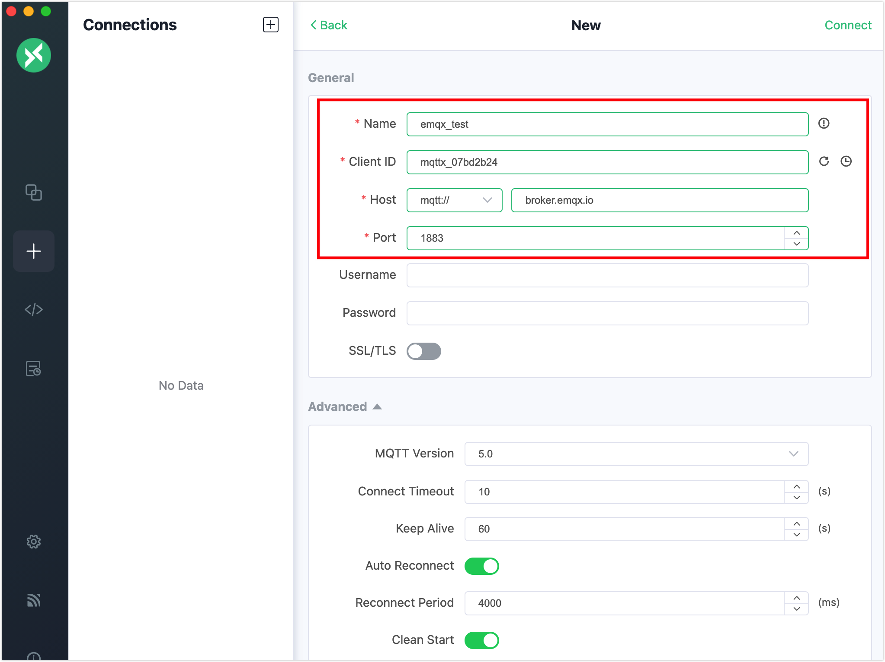
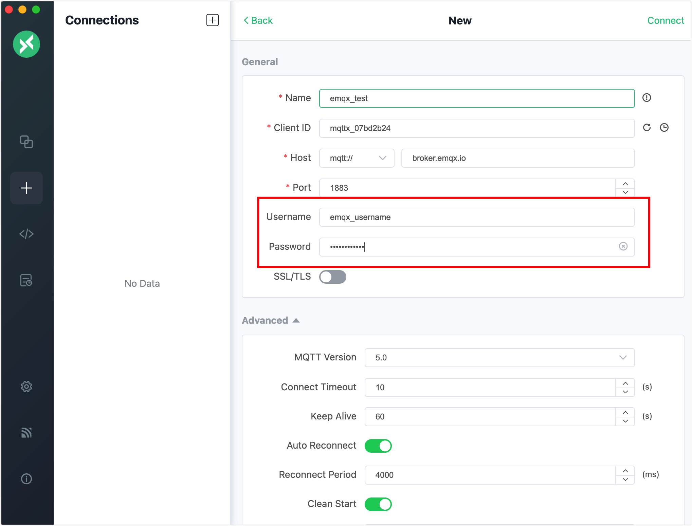

# 创建连接：常规设置

创建连接时，可以在**新建**页面的**常规**区域配置 Broker 信息、用户认证和 SSL/TLS 选项。

## Broker 信息

**Client ID**、**Host** 和**端口**已有默认值，请按 Broker 的实际配置修改。

- **名称**：填写连接名称，例如 `emqx_test`。
- **Client ID**：连接的唯一标识。点击输入框旁的刷新按钮可生成新的值。
- **Host**：选择 `mqtt://` 或 `ws://`；使用 TLS 时选择 `mqtts://` 或 `wss://`。默认主机名为公共 Broker `broker.emqx.io`，可替换为自己的 Broker 主机名或 IP。
  - **Path**：使用 WebSocket 时填写服务端的端点路径，默认为 `/mqtt`。
- **端口**：填写所选协议的监听端口。下表为 EMQX 默认值；如果 Broker 修改过端口，请使用实际配置。

  | 协议     | EMQX 默认端口 |
  | -------- | ------------- |
  | mqtt://  | 1883          |
  | mqtts:// | 8883          |
  | ws://    | 8083          |
  | wss://   | 8084          |

## 用户认证

如果 Broker 开启了用户认证，请填写**用户名**和**密码**。

## SSL/TLS

开启 **SSL/TLS**，可在 MQTTX 与 Broker 之间建立加密连接。

- **SSL/TLS**：启用或禁用 TLS，默认关闭。
- **SSL Secure**：校验服务端证书链和主机名，关闭后跳过这两项校验。开发环境或可信内网中测试未受信任的证书时可临时关闭；生产环境和外部连接应保持开启。
- **CA signed server certificate**：使用受信任的 CA 校验服务端证书。
- **CA or Self-signed certificates**：提供自定义证书。单向认证只需 **CA File**；双向认证还需 **Client Certificate File** 和 **Client key file**。点击各字段旁的文件夹图标选择文件。

## 高级设置

在**高级**区域设置连接超时、[Keep Alive](https://www.emqx.com/zh/blog/mqtt-keep-alive)、Clean Session 或 Clean Start、自动重连和 MQTT 版本。

**MQTT 版本**默认为 `5.0`，也可以选择 `3.1` 或 `3.1.1`。使用 MQTT 5.0 时，可配置会话过期间隔（`Session Expiry Interval`）、接收最大数量（`Receive Maximum`）和主题别名最大值（`Topic Alias Maximum`）等可选属性。

完整选项请参阅[高级与 MQTT 5.0 连接设置](../advanced/advanced-setting.md)。

## 遗嘱消息

在**遗嘱消息**区域配置客户端意外断开时由 Broker 发布的消息。

`Last-Will-QoS` 默认为 `0`，`Last-Will-Retain` 默认为 `False`。填写 `Last-Will-Topic` 和 `Last-Will-Payload` 即可完成配置。

完成配置后，点击右上角的**连接**按钮，创建连接并连接到 MQTT Broker。
