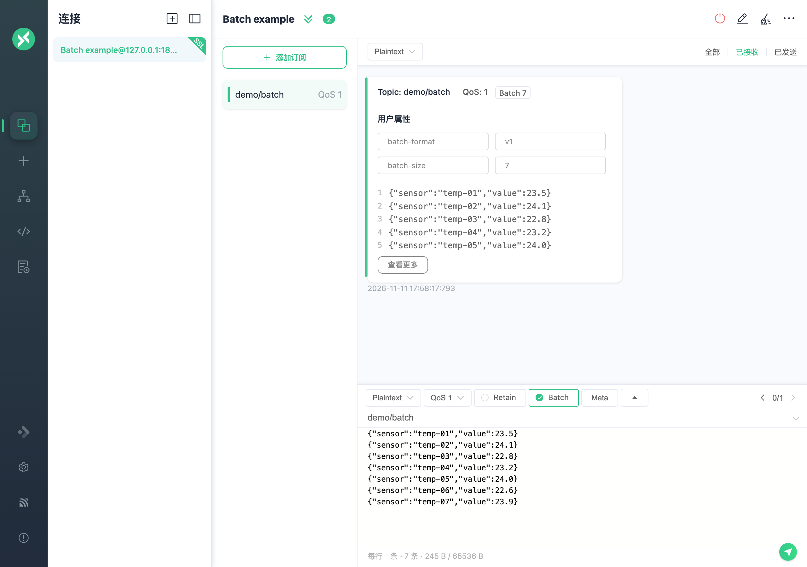
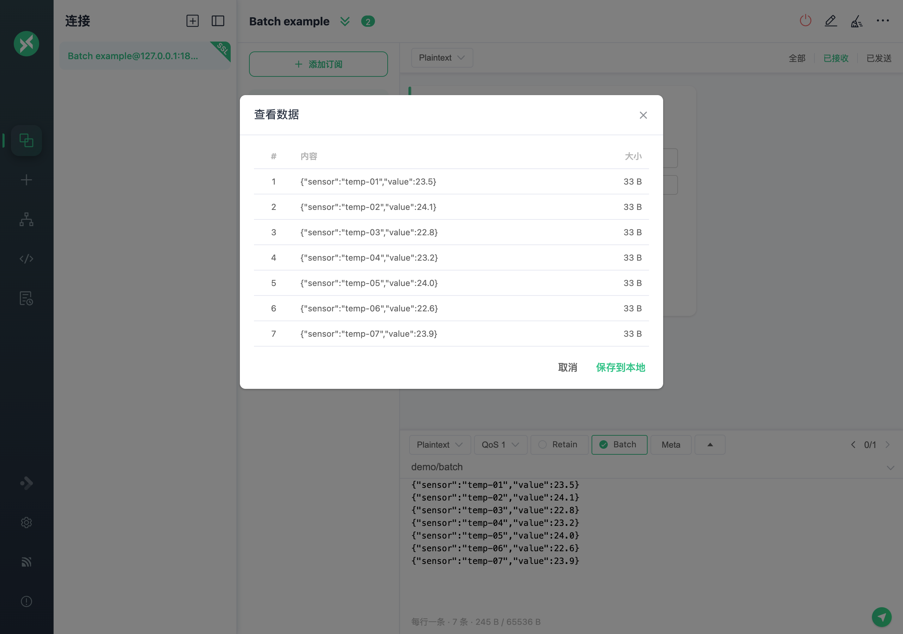

# 消息的发布与订阅

## 主界面

连接成功后，点击顶部连接名称旁的折叠按钮，可查看或修改基本配置。修改前先断开连接，再重新连接使其生效；每次连接成功后，面板会自动折叠。断开连接时，也可以通过右侧的配置按钮修改全部连接设置。


## 添加订阅

点击左下角的 `New Subscription`，输入 [Topic](https://www.emqx.com/zh/blog/advanced-features-of-mqtt-topics)，并选择主题颜色，也可以使用随机颜色。订阅列表右上角的按钮可隐藏列表。

点击订阅可按主题筛选消息，再次点击可取消筛选，也可以直接切换到其他订阅。点击主题名称可复制主题，需要发布时可粘贴到发布区的主题输入框。


添加订阅时可以设置主题别名。订阅列表会显示别名，悬停时显示原始主题，便于区分较长的主题名称。


在订阅弹窗中用逗号分隔多个 Topic，即可一次添加多个主题；主题别名也可以用逗号分隔。


右键点击订阅可选择**编辑**、**禁用**或**启用**。禁用可临时停止接收该主题的消息，启用后即可恢复，无需重新输入主题。


断开连接时，如果开启了 Clean Session（MQTT 3.x）或 Clean Start（MQTT 5.0），可以删除或禁用订阅。持久会话会阻止这些操作：MQTT 3.x 关闭 Clean Session，或 MQTT 5.0 关闭 Clean Start 且 Session Expiry Interval 大于 0 时，Broker 仍保留订阅。新增或编辑订阅仍需先连接。

## 消息发送与接收

在发布区输入已订阅的主题，选择 [QoS](https://www.emqx.com/zh/blog/introduction-to-mqtt-qos) 和 `Retain`，填写 Payload 后点击发送。右侧显示发送的消息，左侧显示接收的消息；向已订阅主题发布时，两侧都会出现对应消息。macOS 用户可按 `Cmd + Enter` 发送，其他系统使用 `Ctrl + Enter`。


在发布区的 `payload` 选项中选择 `Base64`、`Hex`、`JSON`、`Plaintext`、`CBOR` 或 `MsgPack`。消息列表上方的格式选项用于解码接收的消息。

> **注意：** CBOR 和 MsgPack 是高效的二进制格式，相比 JSON 可减小 Payload 体积；两者均使用 JSON 作为输入和输出。

如需使用 `Protobuf` 或 `Avro` 编解码，打开**脚本 > 编解码**。

使用发布区的箭头浏览之前发布过的 Payload。右键点击消息，可复制其 Payload 或主题。

每个连接单独保存发布区（`Topic`、`QoS`、`Retain`、`Payload` 和格式）及发布历史。尚未保存发布区时，会显示该连接最近发送的消息。升级时，旧版共享的发布历史会复制到每个连接。Topic 历史下拉列表中，每条记录的删除图标只删除该条记录。

至此，您就完成了一条 `MQTT` 消息的测试。

## Batch 消息

从 v1.14.0 起，MQTTX 可以把同一主题的多条消息合并成一个 MQTT 报文发送，即 Batch 消息。支持 MQTT 5.0 和 MQTT 3.1.1，QoS 为 0 或 1。

> **注意：** Batch 消息需要 MQTT Broker 支持。使用前，请确认 Broker 和订阅端都支持 Batch 消息。

### 发送 Batch

1. 打开**设置 > 高级**，开启**启用 Batch 发布**。
2. 连接 Broker，填写主题（如 `demo/batch`），选择 `Plaintext` 和 **QoS 1**，勾选 **Batch**。
3. 每行输入一条消息，点击发送：

   ```text
   hello
   {"temperature":23.5}
   world
   ```

编辑器下方会显示条数和大小。超过上限时无法发送，MQTTX 不会自动拆分。



支持 `Plaintext`、`JSON`、`Hex` 和 `Base64`，每行按所选格式编码：JSON 每行写一个完整的值，Hex 写成 `01 FF` 这样的字节，Base64 写成 `QQ==` 这样的编码文本。空行是一条空消息，末尾的换行不算一条。某一行格式不对时，会提示出错的行，并且无法发送。

> **注意：** 如果当前设置与 Batch 冲突，例如格式为 `JSON`、`CBOR` 或 `MsgPack`，或 QoS 为 2，勾选 Batch 时 MQTTX 会列出需要修改的设置，确认后才修改。开启后仍可以重新选择 `JSON`。Payload Format Indicator 需要保持关闭。

### MQTT 5.0 与 3.1.1 的区别

| 连接版本   | 发布时填写   | 订阅主题              | Retain |
| ---------- | ------------ | --------------------- | ------ |
| MQTT 5.0   | `demo/batch` | `demo/batch`          | 支持   |
| MQTT 3.1.1 | `demo/topic` | `$batch/+/demo/topic` | 不支持 |

MQTT 5.0 下，MQTTX 自动添加 `batch-format=v1` 和 `batch-size=N` 两个 User Properties。MQTT 3.1.1 下，实际发布到 `$batch/{N}/demo/topic`，主题框只填 `demo/topic`。订阅 `#` 匹配不到以 `$` 开头的主题。

如果 MQTT 5.0 Broker 要求客户端在连接时声明支持 Batch，请在连接前给连接的 User Properties 添加 `batch-publish`，值为 `v1`，再在连接信息中查看 **Batch 协商** 状态。Broker 未确认时会显示提示，但不会阻止发送。

### 接收与查看

订阅上表中的主题即可。收到的 Batch 会自动识别，不需要开启 Batch 发布。每个 Batch 显示为一条消息，带 **Batch × N** 标签，预览前 5 条。以**完整保存**模式保存且超过 5 条时，点击**查看更多**可以查看每条的内容和大小，每页 100 条；在弹窗中点击**保存到本地**可以导出。



格式错误或超限的 Batch 会显示错误信息和一段十六进制预览。`Plaintext` 格式下，不是 UTF-8 的消息按二进制保存，并标记为**二进制**。

> **注意：** Batch 不执行 Schema 和脚本，收到时也不解压 GZIP。

### 上限与存储

在**设置 > 高级**中配置：

| 设置            | 默认值   | 说明                                                     |
| --------------- | -------- | -------------------------------------------------------- |
| 启用 Batch 发布 | 关闭     | 在发布栏显示 Batch 选项；关闭后退出 Batch 模式。         |
| Batch 最大条数  | `256`    | 发布和接收共用，范围 `1–65535`。                         |
| Batch 最大字节  | `65536`  | 每条消息另占 2 字节长度，计入上限；范围 `1024–1048576`。 |
| Batch 存储模式  | 完整保存 | 保存收到的每一条消息。                                   |

只有开启**启用 Batch 发布**时，才能从发布历史恢复 Batch 模式。

单条消息最大 65,535 字节。MQTT 5.0 下，**Broker 最大报文大小**也会限制整个报文的大小。

选择**仅保存摘要**后，之后收到的 Batch 只保存前 20 条，每条最多 32 字节，并标记为摘要。未保存的部分无法恢复或导出。
