# MQTTX 使用手册

> 本手册适用于 MQTTX 桌面版 v1.13.2。最新文档请访问 [mqttx.app/zh/docs](https://mqttx.app/zh/docs)。

## 目录

- [简介](#简介)
- [下载安装](#下载安装)
- [使用](#使用)
  - [MQTTX Agent](#mqttx-agent)
  - [Dashboard](#dashboard)
- [开发指南](#开发指南)
- [FAQ](#faq)

## 简介

[MQTTX Desktop](https://mqttx.app/zh) 是 [EMQ](https://www.emqx.com/zh) 开源的 MQTT 5.0 桌面客户端，支持 macOS、Windows 和 Linux。它采用聊天式界面，通过 TCP、TLS 和 WebSocket 管理多个连接与订阅，并内置 MQTTX Agent，可用自然语言创建连接、收发消息和排查问题。

从[官网](https://mqttx.app/zh)或 [GitHub](https://github.com/emqx/MQTTX) 下载最新版本，也可以从[源码](https://github.com/emqx/MQTTX)构建。问题和建议请提交 [GitHub issue](https://github.com/emqx/MQTTX/issues)；欢迎 Fork 项目并提交 Pull Request。

### 快速预览


- 支持在 Windows、macOS 和 Linux 上运行
- 100% 兼容 MQTT v5.0、v3.1.1 和 v3.1 协议
- 支持 MQTT 5.0 连接、发布和订阅时的用户属性，以及 SCRAM 增强认证
- 连接页显示 CONNACK 响应信息
- 支持 CA 签名和自签名证书，以及单向、双向 SSL/TLS 认证
- 支持通过 WebSocket 连接 MQTT 服务器
- 内置 MQTTX Agent，可用自然语言操作 MQTTX，支持技能（Skills）、MCP、操作审批和多家模型提供商
- 支持 Plaintext、JSON、Base64、Hex、CBOR 和 MsgPack 等 Payload 格式，并支持 Protobuf 和 Avro 编解码
- 自动解压接收到的 GZIP 消息
- 支持自定义脚本和定时消息，模拟 MQTT 发布/订阅测试
- 视图器工具：主题树、仪表盘、流量监控和消息体查看器
- 每个连接独立保存发布区和发布历史
- 订阅的主题支持自定义颜色标记
- 支持以 JSON、CSV、Excel、XML 和 YAML 格式备份和恢复数据，JSON 备份会保留连接分组
- 支持 Light、Dark、Night 三种主题模式
- 多语言支持：简体中文、英语、日语、土耳其语、匈牙利语及韩语

## 下载安装

请从 [GitHub Releases](https://github.com/emqx/MQTTX/releases) 下载符合您的版本并安装使用。

如果出现网络原因，导致从 GitHub 下载时会出现网速较慢或卡顿的情况时，也可以点击 [这里](https://www.emqx.com/zh/downloads/MQTTX/) ，选择符合您的版本并安装使用。

**注意**：下载时，请尽量选择下载最新版本。

- macOS

如需当前桌面版，请从 [MQTTX 下载页面](https://mqttx.app/zh/downloads)下载安装包。Mac App Store 也提供 MQTTX，但版本可能不同。

[](https://apps.apple.com/cn/app/mqttx/id1514074565?mt=12)

当需要下载文件安装时，请优先选择下载 `dmg`  格式的安装包文件。也可以选择下载 `mac.zip` 的压缩包文件，解压后可快速使用。

**MQTTX 1.13.2 系统要求**：macOS 12 或更高版本。请根据 Mac 的处理器选择 Intel 或 Apple Silicon 安装包。

macOS 的用户还可以选择使用 [brew cask](https://formulae.brew.sh/cask/mqttx) 来安装 MQTTX

```shell
brew install --cask mqttx
```

- Windows

Windows 用户请根据系统架构（64 位 `x64` 或 32 位 `ia32`）下载最新版本的 `exe` 文件，下载后可根据 Setup 的提示进行安装操作。

- Linux

Linux 用户请根据系统架构（`x64` 或 `arm64`）下载最新版本的 `AppImage`、`deb` 或 `rpm` 文件，也可以通过 Flathub 或 Snap Store 安装。

对于使用 `snap` 格式文件进行安装的，还可以执行该命令快速安装，或直接访问 Snap Store 或 Flathub：

[](https://snapcraft.io/mqttx)
<a href='https://flathub.org/apps/details/com.emqx.MQTTX'></a>

```shell
# Flathub
flatpak install flathub com.emqx.MQTTX

# Snap Store（仅支持 x64）
sudo snap install mqttx
```

**注意**：在使用 `snap` 文件安装时，可能会出现权限不够无法安装的问题，详情可参考这条 `issue` [https://github.com/emqx/MQTTX/issues/109](https://github.com/emqx/MQTTX/issues/109)

## 使用

### MQTT Broker 准备

- 如果您不需要本地部署的 MQTT Broker，可以使用免费的[公共 MQTT 5.0 服务器](https://www.emqx.com/zh/mqtt/public-mqtt5-broker)进行快速测试：

  ```text
  地址: broker.emqx.io
  TCP 端口: 1883
  SSL/TLS 端口: 8883
  ```

- 如果您打算在本地运行 MQTT Broker，推荐使用 [EMQX](https://www.emqx.com/zh/products/emqx)，一款开源、云原生、分布式的物联网 MQTT 消息服务器。

  使用 Docker 快速安装 EMQX：

  ```shell
  docker run -d --name emqx -p 1883:1883 -p 8083:8083 -p 8883:8883 -p 8084:8084 -p 18083:18083 emqx/emqx
  ```

### 快速建立连接

准备好 Broker 后，点击左侧栏的 `+` 或**新建连接**，打开连接表单。

没有保存的连接时，欢迎页提供三个入口：

- **新建连接**：打开连接表单，也可以按 `Cmd/Ctrl + N`。
- **连接公共 Broker**：创建名为 `broker.emqx.io` 的连接，并立即连接到 `broker.emqx.io:1883`。
- **导入数据**：导入 JSON、YAML、CSV、XML 或 Excel 文件，成功后应用会重新加载。

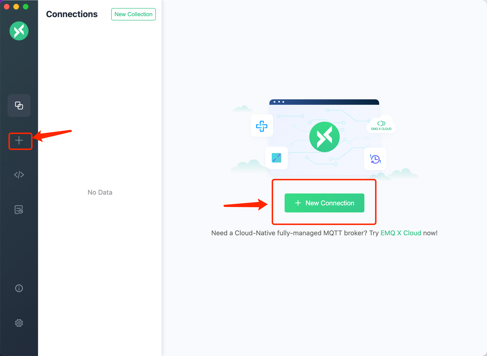

### 客户端相关信息

在连接表单中配置以下信息。

1. Broker 信息

   **Client ID**、**Host** 和**端口**已有默认值，请按 Broker 的实际配置修改。

   - **名称**：填写连接名称，例如 `emqx_test`。
   - **Client ID**：连接的唯一标识。点击输入框旁的刷新按钮可生成新的值。
   - **Host**：选择 `mqtt://` 或 `ws://`；使用 TLS 时选择 `mqtts://` 或 `wss://`。默认主机名为公共 Broker `broker.emqx.io`，可替换为自己的 Broker 主机名或 IP。
     - **Path**：使用 WebSocket 时填写服务端的端点路径，默认为 `/mqtt`。
   - **端口**：填写所选协议的监听端口。下表为 EMQX 默认值；如果 Broker 修改过端口，请使用实际配置。

     | 协议     | EMQX 默认端口 |
     | -------- | ------------- |
     | mqtt://  | 1883          |
     | mqtts:// | 8883          |
     | ws://    | 8083          |
     | wss://   | 8084          |

   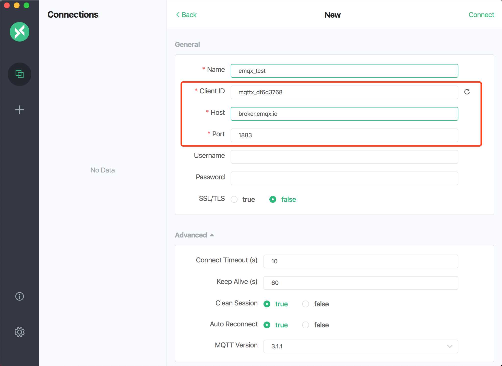

2. 用户认证信息

   如果 Broker 开启了用户认证，请填写**用户名**和**密码**。

   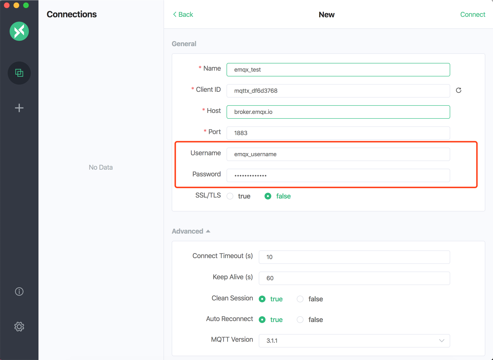

3. SSL/TLS

   开启 **SSL/TLS**，可在 MQTTX 与 Broker 之间建立加密连接。

   - **SSL/TLS**：启用或禁用 TLS，默认关闭。
   - **SSL Secure**：校验服务端证书链和主机名，关闭后跳过这两项校验。开发环境或可信内网中测试未受信任的证书时可临时关闭；生产环境和外部连接应保持开启。
   - **CA signed server certificate**：使用受信任的 CA 校验服务端证书。
   - **CA or Self-signed certificates**：提供自定义证书。单向认证只需 **CA File**；双向认证还需 **Client Certificate File** 和 **Client key file**。点击各字段旁的文件夹图标选择文件。

   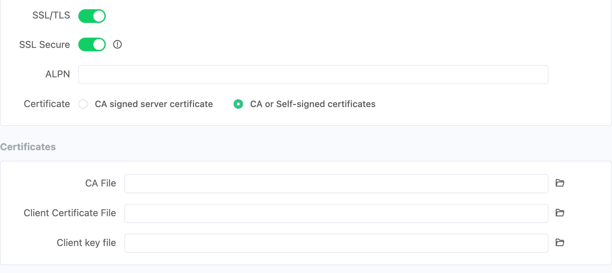

4. 高级配置

   在**高级**区域设置连接超时、[Keep Alive](https://www.emqx.com/zh/blog/mqtt-keep-alive)、Clean Session 或 Clean Start、自动重连和 MQTT 版本。

5. MQTT 5.0

   **MQTT 版本**默认为 `5.0`，也可以选择 `3.1` 或 `3.1.1`。使用 MQTT 5.0 时，可配置会话过期间隔（`Session Expiry Interval`）、接收最大数量（`Receive Maximum`）和主题别名最大值（`Topic Alias Maximum`）等可选属性。

   

6. 遗嘱消息

   在**遗嘱消息**区域配置客户端意外断开时由 Broker 发布的消息。

   `Last-Will-QoS` 默认为 `0`，`Last-Will-Retain` 默认为 `False`。填写 `Last-Will-Topic` 和 `Last-Will-Payload` 即可完成配置。

   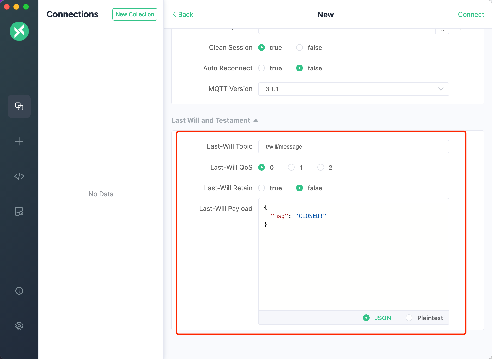

完成配置后，点击右上角的**连接**按钮，创建连接并连接到 Broker。

### 消息的发布订阅

1. 主界面

   连接成功后，点击顶部连接名称旁的折叠按钮，可查看或修改基本配置。修改前先断开连接，再重新连接使其生效；每次连接成功后，面板会自动折叠。断开连接时，也可以通过右侧的配置按钮修改全部连接设置。

   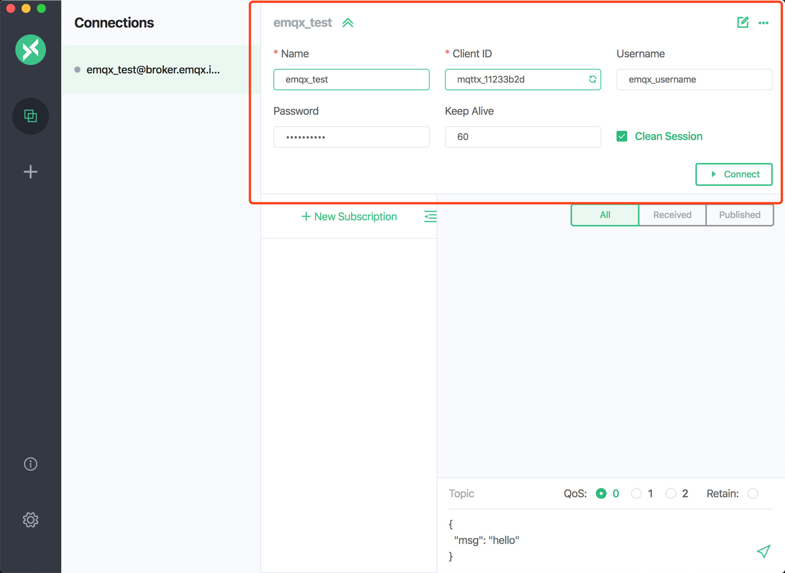

2. 添加订阅

   点击左下角的 `New Subscription`，输入 [Topic](https://www.emqx.com/zh/blog/advanced-features-of-mqtt-topics)，并选择主题颜色，也可以使用随机颜色。订阅列表右上角的按钮可隐藏列表。

   点击订阅可按主题筛选消息，再次点击可取消筛选，也可以直接切换到其他订阅。点击主题名称可复制主题，需要发布时可粘贴到发布区的主题输入框。

   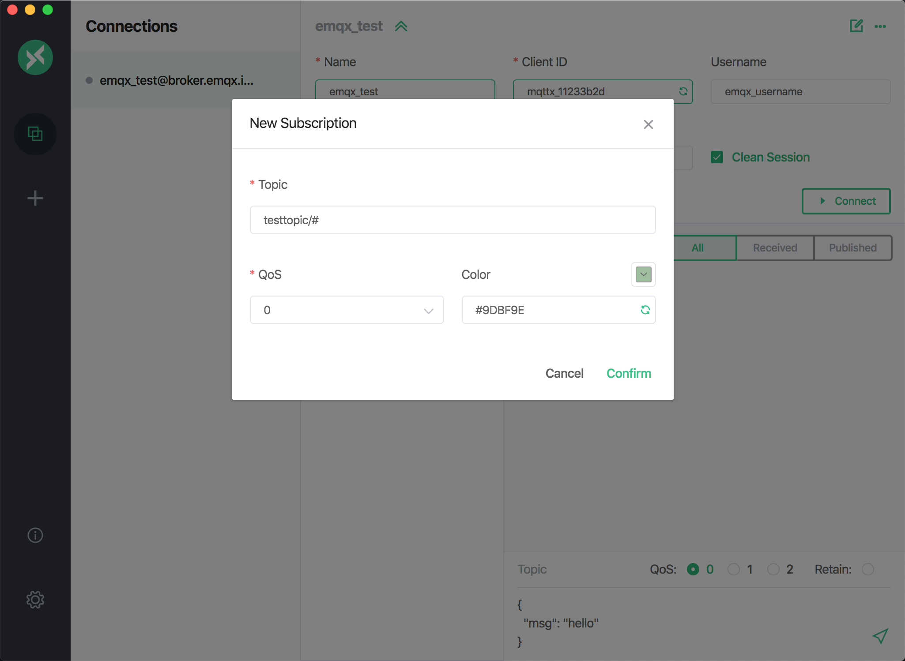

   添加订阅时可以设置主题别名。订阅列表会显示别名，悬停时显示原始主题，便于区分较长的主题名称。

   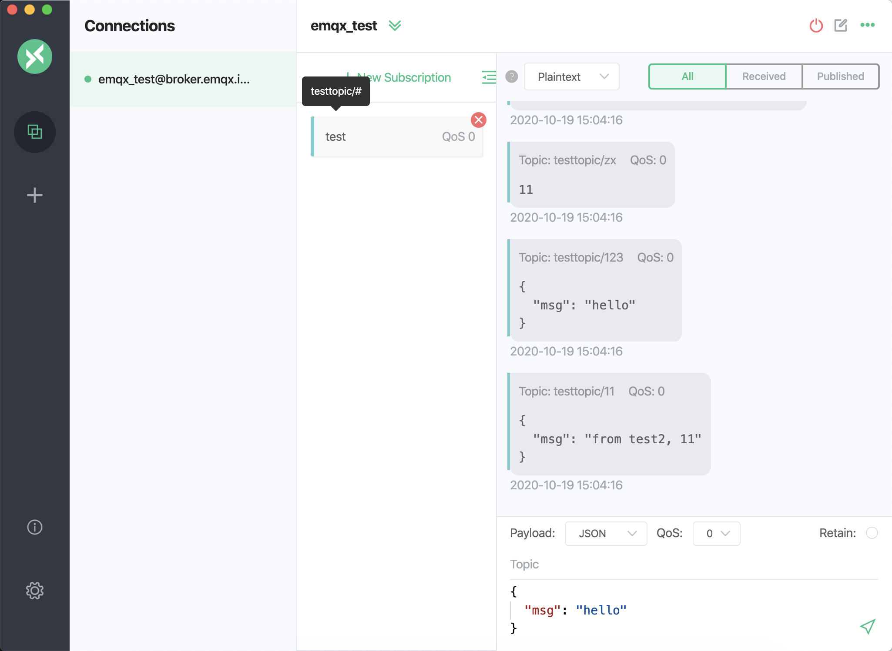

   在订阅弹窗中用逗号分隔多个 Topic，即可一次添加多个主题；主题别名也可以用逗号分隔。

   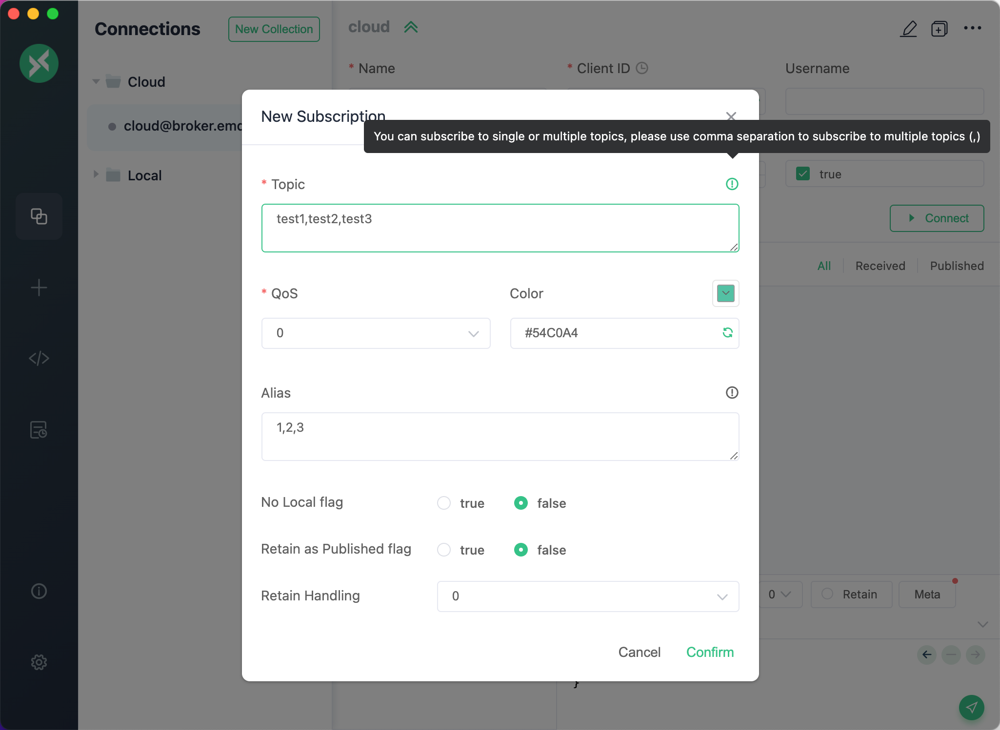

   右键点击订阅可选择**编辑**、**禁用**或**启用**。禁用可临时停止接收该主题的消息，启用后即可恢复，无需重新输入主题。

   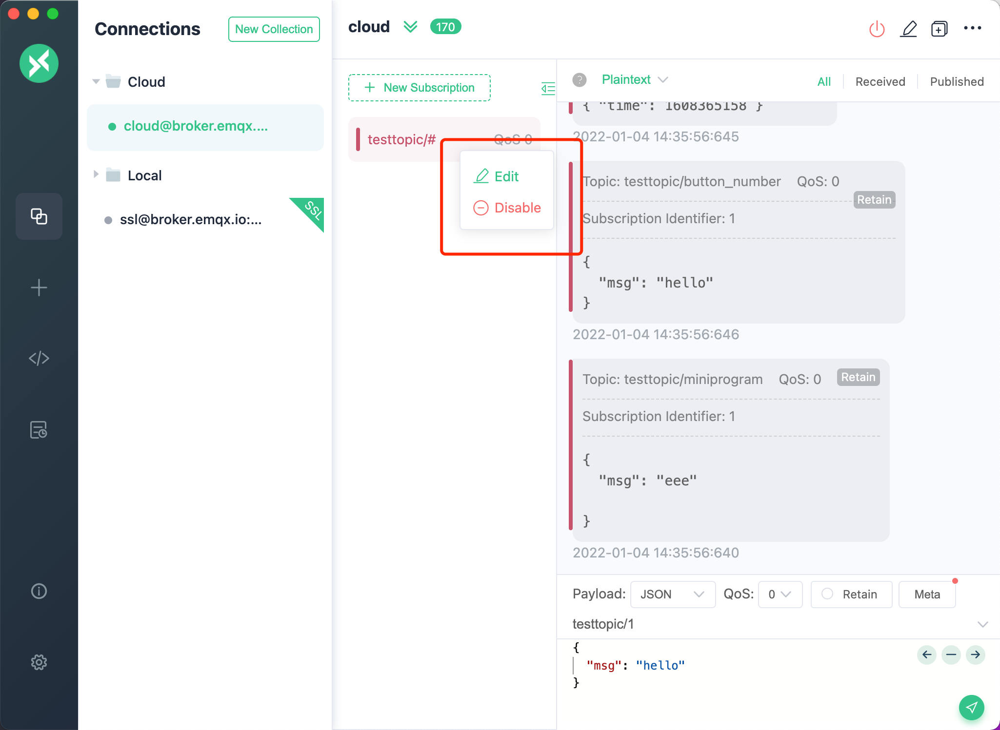

   断开连接时，如果开启了 Clean Session（MQTT 3.x）或 Clean Start（MQTT 5.0），可以删除或禁用订阅。持久会话会阻止这些操作：MQTT 3.x 关闭 Clean Session，或 MQTT 5.0 关闭 Clean Start 且 Session Expiry Interval 大于 0 时，Broker 仍保留订阅。新增或编辑订阅仍需先连接。

3. 消息发送与接收

   在发布区输入已订阅的主题，选择 [QoS](https://www.emqx.com/zh/blog/introduction-to-mqtt-qos) 和 `Retain`，填写 Payload 后点击发送。右侧显示发送的消息，左侧显示接收的消息；向已订阅主题发布时，两侧都会出现对应消息。macOS 用户可按 `Cmd + Enter` 发送，其他系统使用 `Ctrl + Enter`。

   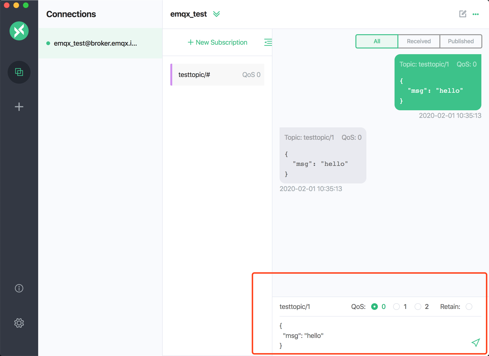

   在发布区的 `payload` 选项中选择 `Base64`、`Hex`、`JSON`、`Plaintext`、`CBOR` 或 `MsgPack`。消息列表上方的格式选项用于解码接收的消息。

   > **注意：** CBOR 和 MsgPack 是高效的二进制格式，相比 JSON 可减小 Payload 体积；两者均使用 JSON 作为输入和输出。

   如需使用 `Protobuf` 或 `Avro` 编解码，打开**脚本 > 编解码**。

   使用发布区的箭头浏览之前发布过的 Payload。右键点击消息，可复制其 Payload 或主题。

   每个连接单独保存发布区（`Topic`、`QoS`、`Retain`、`Payload` 和格式）及发布历史。尚未保存发布区时，会显示该连接最近发送的消息。升级时，旧版共享的发布历史会复制到每个连接。Topic 历史下拉列表中，每条记录的删除图标只删除该条记录。

   至此，您就完成了一条 `MQTT` 消息的测试。

### MQTT 5

1. 用户属性

    点击新建按钮，来到新建客户端的页面，首先我们需要选择 MQTT 的版本为 5.0，这样就可以看到下方出现了配置用户属性的卡片，卡片内是一个可以配置键值对的输入框，可以点击右上角的添加按钮，来增加用户属性配置，点击每一行末尾的删除按钮可以删除配置，最后输入需要配置的属性名称和内容即可。连接成功后，MQTT 服务器就可以获取到该客户端的用户属性内容。

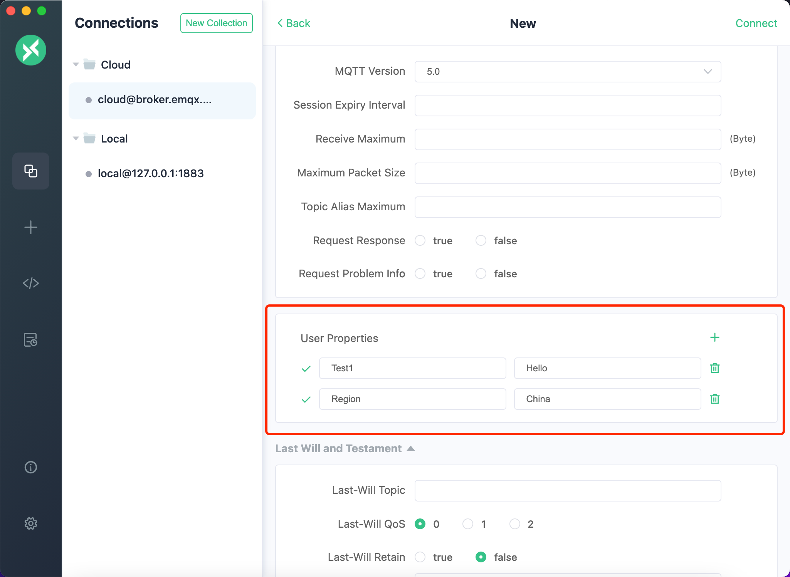

    除了客户端连接时的用户属性配置外，该版本还支持配置发布消息时的用户属性。当新建连接为 MQTT 5.0 的客户端时，我们可以看到右下角的发布消息的区域出现了一个 Meta 按钮，点击该按钮即可出现配置发布时的属性的卡片，我们可以在卡片顶部看到用户属性配置。

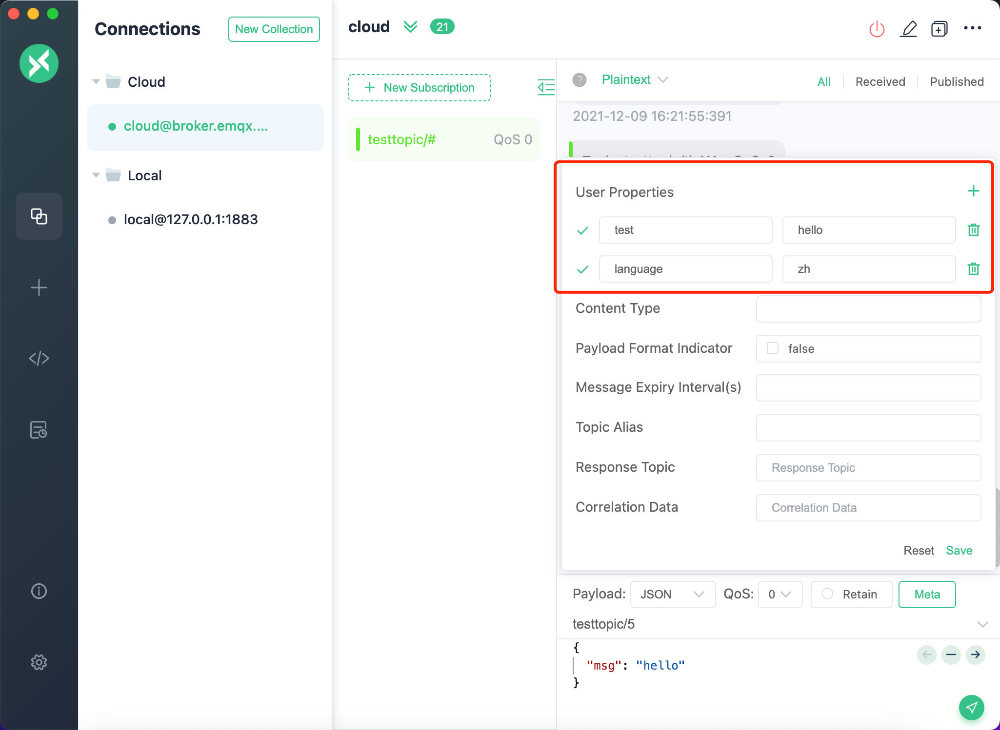

    对于 MQTT 5.0 连接，还可以在新建或编辑订阅弹窗中添加用户属性，这些属性会随 SUBSCRIBE 报文一起发送，例如 EMQX MQTT Streams 使用的 `stream-offset` 属性。点击订阅列表中订阅旁的图标，即可查看其用户属性。

2. 请求响应

    点击 Meta 按钮，输入框内输入一个响应主题：/ack/1，输入一个对比数据：light，并在当前连接客户端订阅一个 /ack/1。

    MQTTX 也可以显示 Broker 返回的响应信息。在 MQTT 5.0 连接的高级设置中开启 `请求响应信息`，当 Broker 在 CONNACK 中返回 Response Information 时，连接页顶部的连接信息区会显示 `响应信息`（即 Response Information 的值）和复制按钮，连接设置折叠时也依然显示。内容过长时，点击即可查看完整内容。MQTT 3.x 连接或连接断开时不显示。

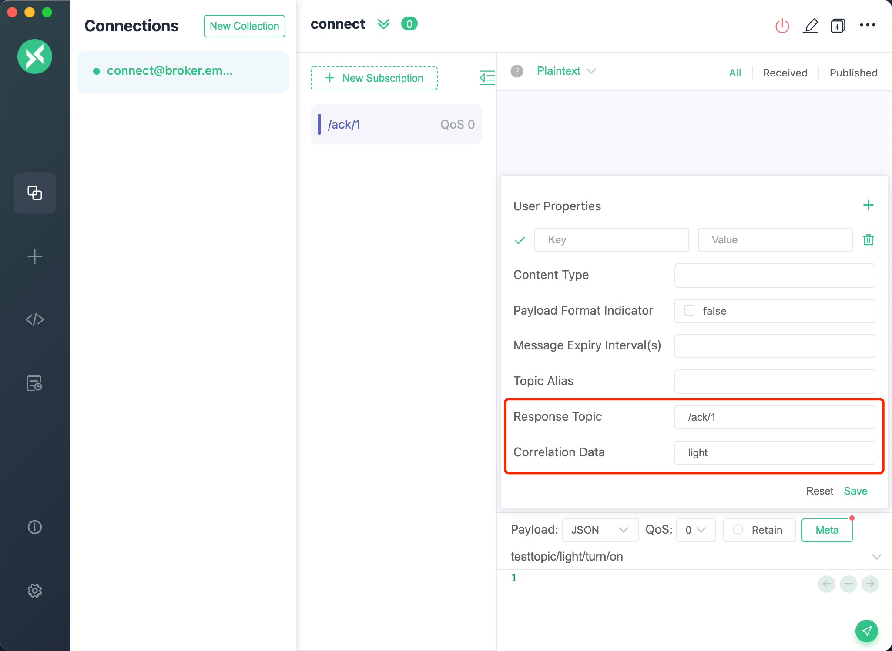

3. 内容类型和载荷格式

    点击 Meta 按钮，在输入框内输入 Content Type，点击设置 Payload Format Indicator 的值后，发布消息即可。

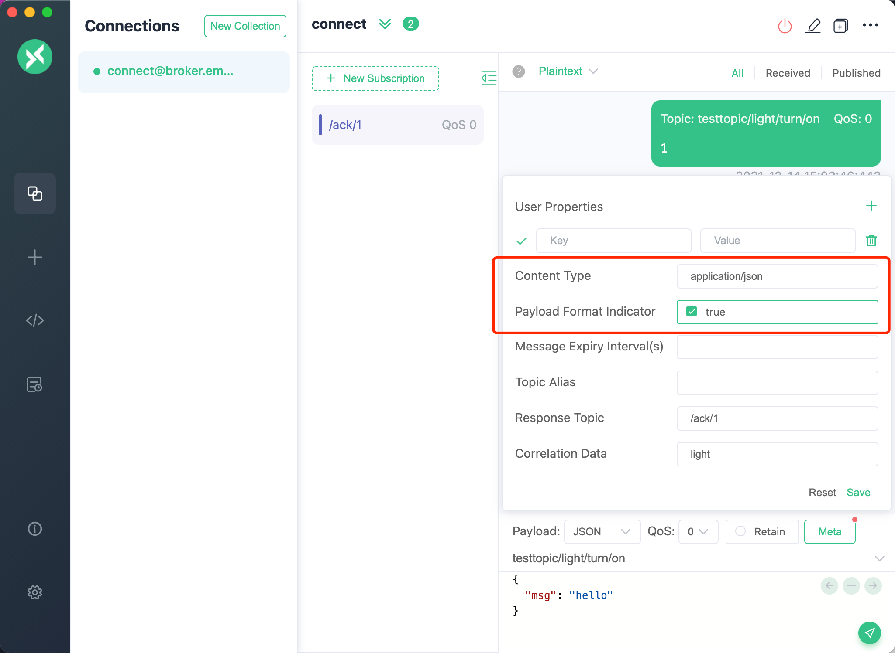

4. SCRAM 增强认证

    如果您的 Broker 开启了 SCRAM 认证，可以在连接配置的 `Authentication Method` 下拉框中选择 `SCRAM-SHA-1`、`SCRAM-SHA-256` 或 `SCRAM-SHA-512`，然后使用用户名和密码连接。

5. 订阅标识符和订阅选项

    我们打开订阅主题的弹出框，下方可以设置 Subscription Identifier 和包含了 No Local、Retain as Published 和 Retain Handling 的订阅选项。用户可以在订阅报文中指定一个数字订阅标识符，并在消息分发时返回此标识符。客户端可以建立订阅标识符与消息处理程序的映射，以在收到 PUBLISH 报文时直接通过订阅标识符将消息定向至对应的消息处理程序，同时可以配置这些订阅选项来改变服务端的行为。

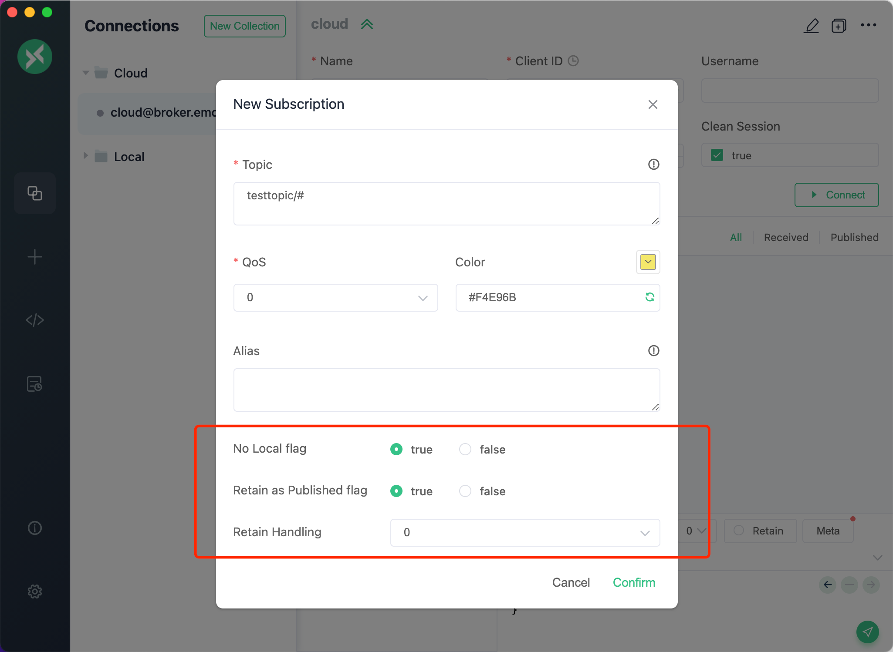

### 设置

点击左侧菜单栏底部的设置按钮，或使用快捷键，macOS 用户可以使用 `command + ,` 快捷键，其它用户可以使用 `control + ,` 快捷键来跳转到设置页面。设置页面包含以下部分：

- **基础**：语言、自动检查更新、自动恢复订阅、多主题订阅、最大重连次数和最大 Payload 显示大小。
- **外观**：同步操作系统主题、主题（Light、Dark 或 Night）以及 JSON 数据高亮。
- **扩展**：一键安装 MQTTX CLI。
- **高级**：日志等级、数据恢复和备份、清除历史数据、忽略 QoS 0 消息、自动解压 GZIP 消息、主题空格检测以及 GPU 加速。
- **MQTTX Agent**：启用 Agent，配置模型服务商、推理强度、默认权限模式、每次回复的最大步数和 MCP 服务器，详见 [MQTTX Agent](./desktop/zh/use-desktop/agent.md)。

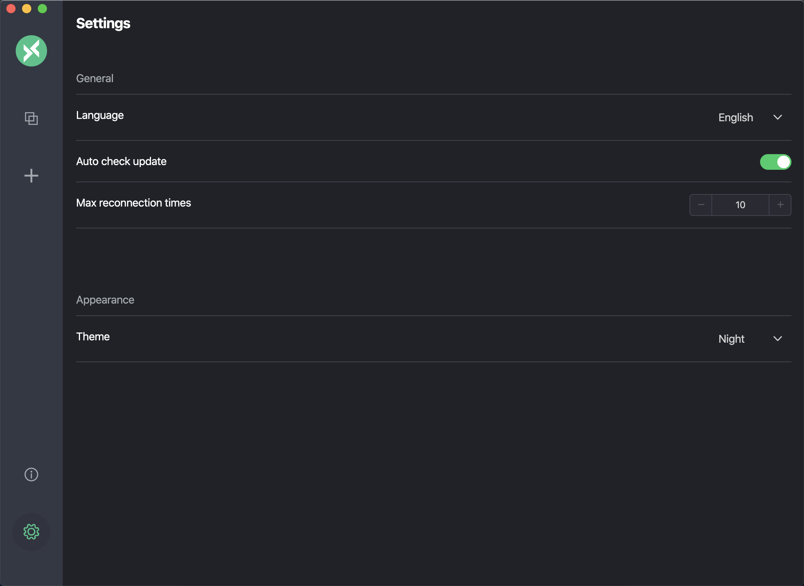

**GZIP 解压**

高级设置中的 `自动解压 GZIP 消息` 开关用于解压接收到的 GZIP 消息，默认关闭。以 gzip 魔数 `1f 8b` 开头的接收消息会先解压，再按所选的 Payload 格式或 Schema 解码；不是 gzip 的消息保持不变。解压失败的消息会被标记为错误，并保留原始内容。解压成功的消息会在 QoS 旁显示 `GZIP` 标记（悬停即可看到 `已自动解压 GZIP`），该标记会随消息一起保存，关闭开关或重启 MQTTX 后，历史消息中仍会显示。

#### 数据管理

高级设置中包含了数据的备份与恢复功能。用户可选择两种导入导出的方式，也可以通过连接页面中的右上角菜单，或者在设置页面中的高级功能栏里。

在设置页面里可以在最下方的高级功能中，选择点击数据备份和数据恢复两个按钮。选择数据备份时，将导出所有的连接数据，包含所有收发到的消息等。选择数据恢复时，选择完导入文件的路径，确认后即可恢复数据。文件格式支持 `JSON`、`XML`、`CSV`、`Excel` 和 `YAML`。

使用 `JSON` 格式备份时还会保留连接分组：嵌套分组和空分组、分组顺序，以及每个连接所属的分组，导出单个连接为 JSON 时也会包含它的上级分组。其他格式保持原有结构，不包含分组。仅包含连接的旧备份仍然可以导入，其中的连接会放在根级；导入已存在的 ID 会更新对应数据；如果文件中存在 ID 冲突、缺失的分组引用或循环的分组层级，整份导入都会回滚。

恢复后连接保持断开状态。JSON 兼容和导入冲突规则请参阅[高级设置](https://mqttx.app/zh/docs/advanced#备份与恢复)。

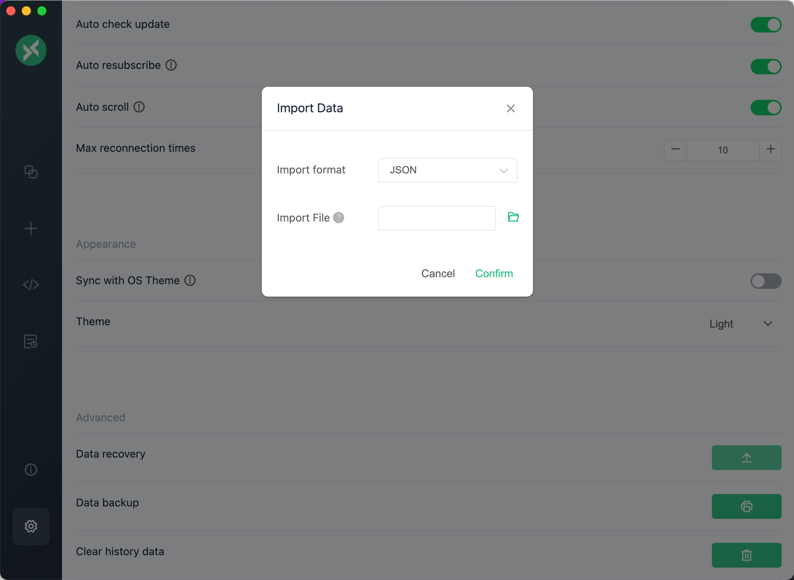

### MQTTX Agent

MQTTX Agent 是内置于桌面客户端的 AI Agent，支持通过自然语言操作 MQTTX，涵盖连接管理、消息收发、日志分析、脚本与 Schema 生成和数据视图创建。连接信息与工具结果保留在对话中，为后续分析提供上下文。对于协议已明确的 MQTT 设备，Agent 可读取状态、发布请求的控制指令，并检查新回报；连接需保持活动且订阅对应回报主题，没有新回报时无法确认设备结果。

在 **设置 → MQTTX Agent** 中开启，配置服务商的 **API Host**、**API Key** 和**模型**，再通过左侧栏或 `Cmd/Ctrl + J` 打开。全屏适合集中处理较长对话，浮窗支持同时查看 MQTTX 其他页面。

默认的**操作前询问**模式会自动执行读取，并在变更和 MCP 工具调用前请求批准。**自动**模式跳过这些提示，脚本测试仍始终需要批准。Skill 为代码生成、连接诊断等具体任务提供指引，`@` 提及则为请求提供对应连接的信息。

Zero EMQX Skill 支持创建免费的临时测试 Broker 并保存 TLS 连接。连接到 Broker 是独立操作，需要在请求中一并说明。实例会按 Zero EMQX 返回的生命周期到期，适合测试。

对话和工具结果会发送给已配置的模型服务商。完整控件、附件、隐私和限制说明请参阅 [MQTTX Agent](./desktop/zh/use-desktop/agent.md)。

### Dashboard

Dashboard 用于在 MQTT 测试和流量检查中查看设备当前读数及其变化。Big Number、Gauge 和 Line 组件将 Payload 中的数值字段展示为当前数值、范围和趋势。

先连接并订阅数据源，再进入 **视图器 → 仪表盘**，创建仪表盘和组件，为每个组件选择连接、主题过滤器与 Payload 字段。在组件中选择过滤器不会创建 Broker 订阅。历史时间选择器读取 MQTTX 本机已经保存的消息。

完整手动操作流程请参阅 [Dashboard](./desktop/zh/use-desktop/dashboard.md)。

### 脚本

MQTTX 提供脚本编辑功能。用户可编写自定义函数（JavaScript）对发送和接收的 `Payload` 进行转换，也可以编写自定义 Schema（`Protobuf` 或 `Avro`）进行编解码。配合定时消息，可实现模拟数据上报等自动化测试。

点击左侧菜单栏中的 `脚本` 按钮，可进入到脚本编辑页面，在该页面中，用户可在最上方的代码编辑器中，编写 JavaScript 代码，全局只包含一个 `execute` API，用户需要编写一个脚本函数，该函数接收一个 `value` 参数，即为 `Payload`, 函数中便可对 `value` 进行自定义修改转化，最后将该函数作为参数传入到 `execute` 中即可执行自定义编写的函数。

下方还包含了一个 `输入` 和 `输出` 框，可输入预想输入值，点击右边的 `测试` 按钮，便可在 `输出` 框中查看执行结果，输入的值的格式包含了 `JSON` 和 `Plaintext`，方便用户提前调试自定义编写的脚本功能。完成测试后，可点击最右上角的 `保存` 按钮，输入该脚本的名称后就可对该脚本进行保存。保存完成后就可以到连接页面进行使用了。保存完成的脚本还可进行编辑和删除。

在连接页面中，点击右上角的下拉功能菜单，选择 `运行脚本`，在弹出窗中，选择你需要使用的预先保存好的脚本，然后选择应用类型，包含了，发送时，接收时和全部。选择完成后，根据数据类型选择发送或接收的数据格式，正常使用消息的收发，此时如果看到预期效果，便完成了一个完整的脚本使用的功能。如果用户需要取消脚本，可点击顶部状态栏中的红色的 `停止脚本` 按钮，便可停止使用脚本。

该功能具有一定的扩展性和灵活性，需用户配合实际需求来进行使用。


脚本示例可在 [scripts-example](https://github.com/emqx/MQTTX/tree/main/scripts-example) 文件夹中查看，包括自定义函数、Schema 和物联网数据场景。如果您有更好、更实用的脚本，也欢迎提交到这里，让更多人使用。

### 日志

MQTTX 提供日志记录功能，方便用户调试连接、报告错误。日志系统包含 4 个级别，可以在设置页面的高级设置中选择日志等级：

- DEBUG 提供详细的调试信息，包括 MQTT.js 的报文详情
- INFO 用于提示用户操作信息
- WARN 产生不安全/潜在风险的警告
- ERROR 产生失败的错误

默认情况下，日志会被写入 log 文件：

- Linux: `~/.config/MQTTX/logs/log`
- macOS: `~/Library/Application Support/MQTTX/logs/log`
- Windows: `%USERPROFILE%\AppData\Roaming\MQTTX\logs\log`

在每次关闭 MQTTX 时，当前的日志文件会按 UTC 时间戳重命名为 `YYYY-MM-DDThh-mm-ss.log` 格式。


### 视图器

左侧菜单栏中的视图器提供 MQTT 数据可视化功能：

- **主题树**（Beta）：以层级结构展示接收到的主题和消息，支持搜索、图形化查看，以及从连接同步历史消息。可拖动分隔线调整信息面板，宽度会被记住；子主题区域显示直接子节点、数量和层级。显示限制请参阅[主题树](https://mqttx.app/zh/docs/advanced#主题树beta)。
- **仪表盘**：使用 Big Number、Line 或 Gauge 组件展示实时消息中的数据。为组件选择连接、主题模式和 Payload 字段，拖动或缩放组件调整布局，并通过时间范围查看历史数据。配置和历史数据限制请参阅[仪表盘](./desktop/zh/use-desktop/dashboard.md)。
- **流量监控**：根据 `$SYS` 系统主题绘制 Broker 的收发流量图表。从连接页面进入时会自动订阅 `$SYS/#`。

    > EMQX 默认只允许本机的客户端订阅 `$SYS` 主题。如需远程访问，请修改 Broker 的 ACL 规则。

- **消息体查看器**：查看单个主题的消息。差异视图会将每条消息与上一条进行对比，JSON 树以可搜索的树形结构展示 JSON 格式的 Payload，也可以图形化展示。

### 其它

1. 连接操作

    点击顶部的操作栏按钮，可以快速断开连接、删除当前连接、导入导出当前数据、设置定时消息等。在连接列表中右键点击连接，可以复制连接、在新窗口中打开，或者复制其 Host 或 Broker 地址。

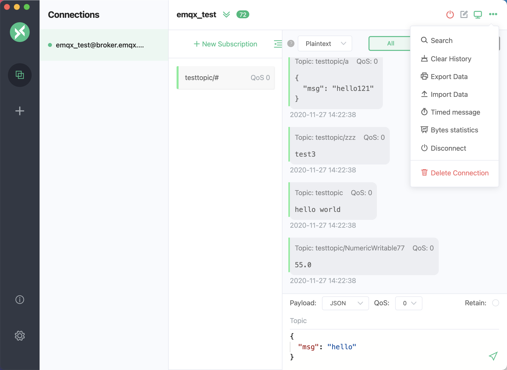

2. 消息处理

    在消息栏右上角的 `All`，`Received`， `Published` 按钮可以过滤出
    全部消息，已接收的消息，和已发布的消息。

    点击顶部的操作栏按钮，选择 `Search` 项，或使用快捷键，macOS 用户可以使用 `command + f` 快捷键，其它用户可以使用 `control + f` 快捷键，来打开按 `Topic` 搜索的的功能，支持主题和消息内容的模糊查询。

    点击连接页顶部工具栏中的 `清除历史记录` 按钮，可以清除当前连接的发送和接收消息。点击后会先弹出确认框，其中会写明连接名称，确认后才会清除。

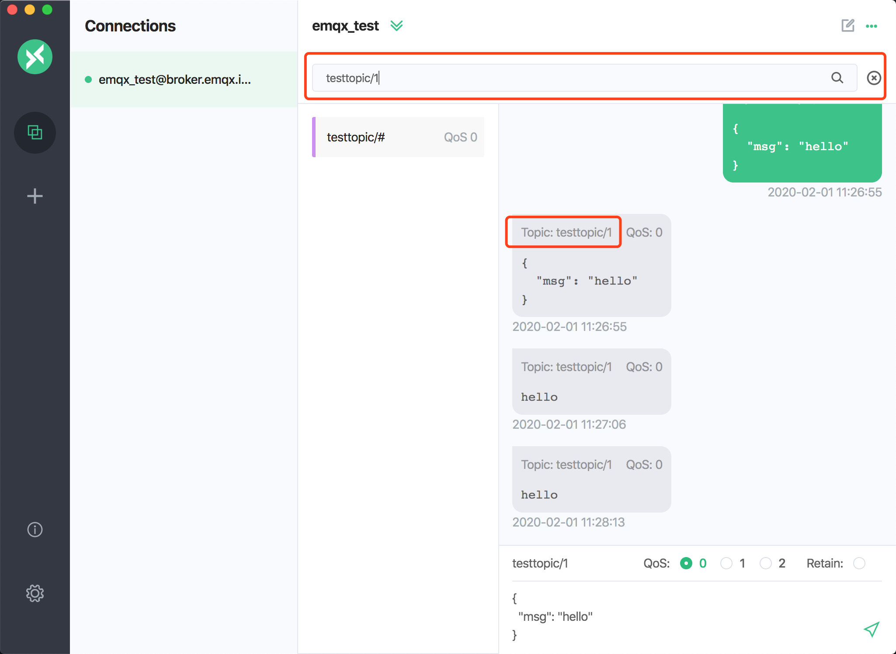

3. 检查更新

    点击左侧底部的 `i` 按钮，可进入到 `About` 页面，了解 [MQTTX](https://mqttx.app/zh) 的版本信息和 [EMQX](https://emqx.cn) 的相关信息。点击 `Check for Updates` 可以检查是否有更新版本。

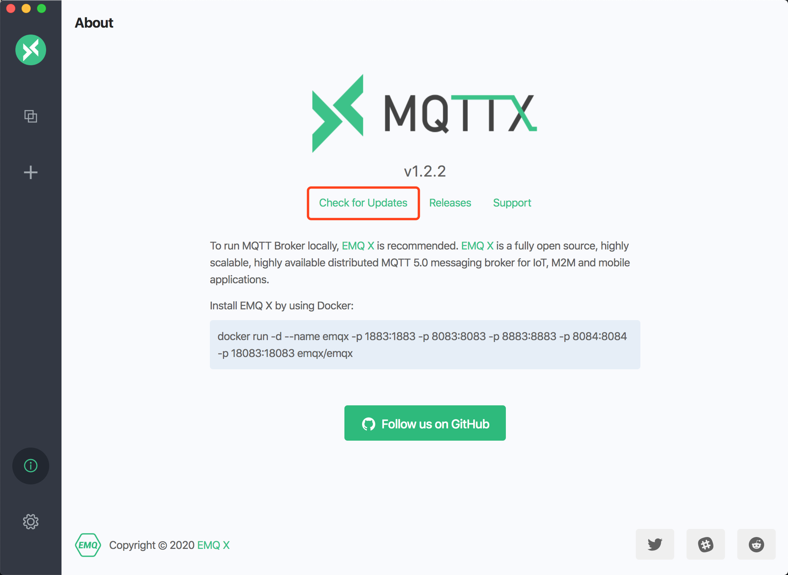

4. 最大重连数

    设置页面的基础设置中有一个最大重连次数设置，可以设置一个整数，当 `Broker` 断开，或者连接不上的情况下时，重连次数超过该数值，连接将会彻底断开。

5. 多窗口

    在连接列表中，右键点击，选择新建窗口，为该连接创建新窗口。在新窗口中，同样可以进行连接，订阅主题，发布和接受消息等。如果当创建的多个连接之间存在某种联系时，或需要查看同时接受到的消息，可以新建多个视图窗口，同时进行查看。在 v1.4.1 版本以后，用户还可点击顶部的窗口按钮，快速新建窗口。

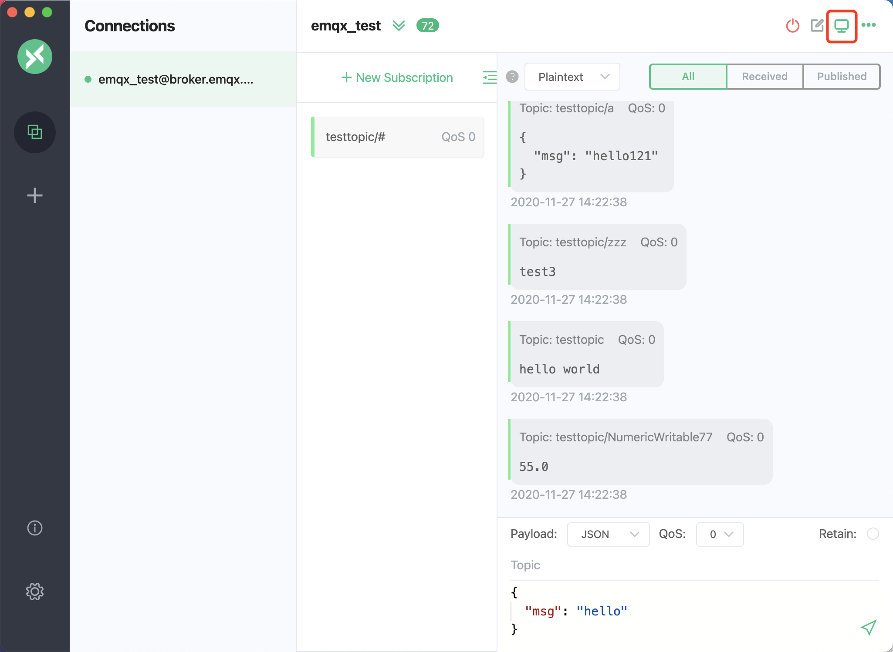

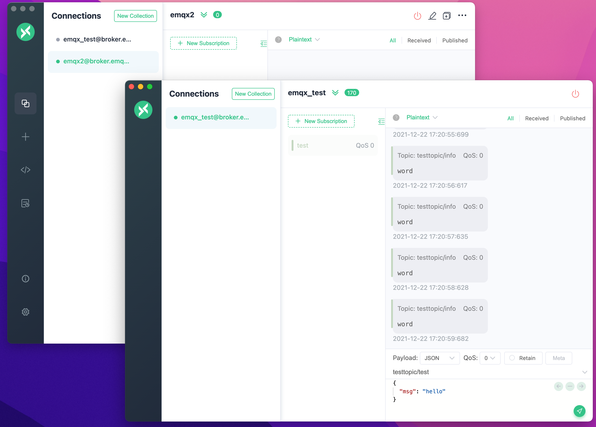

6. 定时消息

    在右上角的下拉菜单中，可点击定时消息项，设置发送频率，单位为秒，设置完成后手动发送一条消息，将会自动根据设置的发送频率自动发送消息。

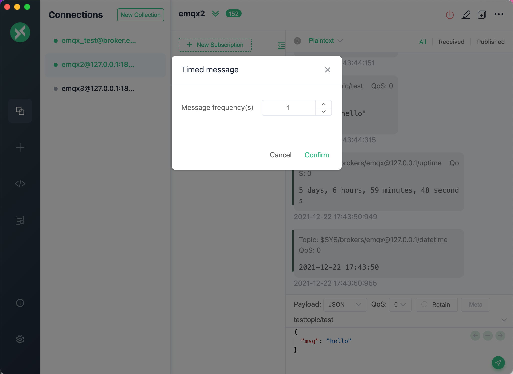

## 开发指南

开发使用 Git、Yarn 和 [`.nvmrc`](../.nvmrc) 指定的 Node.js 22，建议了解 Vue.js、Electron 和 TypeScript。下方命令使用 [nvm](https://github.com/nvm-sh/nvm)；使用其他版本管理器时，请选择相同的 Node.js 版本。如需贡献代码，请先 Fork 仓库并克隆自己的 Fork。

``` shell
# 克隆项目
git clone https://github.com/emqx/MQTTX.git

# 安装依赖
cd MQTTX
nvm use
yarn install

# 以开发模式运行，支持热重载
yarn run electron:serve

# 构建 Windows、Linux 和 macOS 安装包
yarn run electron:build
```

安装包会输出到 `dist_electron` 目录。如果只需构建单个平台，请运行以下命令之一：

```shell
yarn run electron:build-win
yarn run electron:build-linux
yarn run electron:build-mac
```

## FAQ

**Q: MQTT 客户端是什么？**

MQTT 客户端是任何运行 MQTT 库并通过网络连接到 MQTT Broker 的设备。发布者和订阅者指的是客户端当前是发布消息还是订阅接收消息，发布者和订阅者可以都是一个 MQTT 客户端，（发布和订阅功能也可以在同一个 MQTT 客户端中实现）。MQTT 客户端可以是一个非常小的、资源有限的设备，也可以是一台运行图形化 MQTT 客户端的典型计算机软件，基本上用于测试目的。因此可以简单理解任何通过 TCP/IP 协议连接到 MQTT 服务的设备或软件都可以被称为 MQTT 客户端。

**Q: 为什么使用 MQTTX？**

MQTTX 是一款开源的跨平台 MQTT 桌面客户端工具。可以用于正在搭建自己的 MQTT 的消息服务器的用户，或者正在开发 MQTT Broker 和研究学习 MQTT 的相关用户学习来测试连接，订阅和发布消息等。用户可以快速建立多个连接客户端，方便快速测试 MQTT/TCP、MQTT/TLS 的连接、发布/订阅功能及其他特性。在 MQTT 的研究与应用中可以通过 MQTTX 快速、深入地理解 MQTT 协议相关特性。

**Q: MQTTX 为什么采用聊天软件的设计？**

基于对 MQTT 协议中发布订阅的理解，我们使用聊天软件的交互形式来帮助用户快速理解 MQTT 协议的核心内容，比如新建一个连接，可以想象为用户 A，订阅一个 Topic，即加入一个聊天频道，再新建一个连接，即为用户 B，向用户 A 订阅过的 Topic 发布一条消息，我们可以在用户 A 的页面中接收到用户 B 发送过来的消息。而中间转发消息的服务即为 MQTT Broker。其实在 IoT 世界中也是这样的，设备之间可以利用 MQTT 这样发布订阅的特性来进行通讯。而 MQTTX 将其进行模拟并转化到用户界面中，帮助用户更快的理解和测试 MQTT 相关内容。

**Q: MQTTX 是免费的吗？**

是的。完全开源，详情见 [LICENSE](https://github.com/emqx/MQTTX/blob/main/LICENSE)。

**Q: 当您使用 MQTTX 遇到问题时，该怎么做？**

1. 您可以打开 MQTTX 的 [GitHub](https://github.com/emqx/MQTTX) 链接，进入到 [issue](https://github.com/emqx/MQTTX/issues?q=is%3Aissue+is%3Aopen+sort%3Aupdated-desc) 区，点击提交 issue 来反馈问题。
2. 中文用户可以到我们的[EMQ 问答社区](https://askemq.com/c/tools/11)来进行问题反馈。
3. 最后可以通过以下联系方式联系我们，反馈您使用中的任何问题。

## 联系方式

| 方式                              | 内容                                                                   |
| --------------------------------- | ---------------------------------------------------------------------- |
| QQ 群（EMQX 官方群3）             | 937041105                                                              |
| EMQX 官方公众号                   |  |
| EMQX 微信群（扫码添加后邀请入群） |       |
| 微博                              | [@emqtt](https://weibo.com/emqtt)                                      |
| X                                 | [@EMQTech](https://x.com/EMQTech)                                      |
| Slack                             | [EMQX](https://slack-invite.emqx.io/)                                  |
